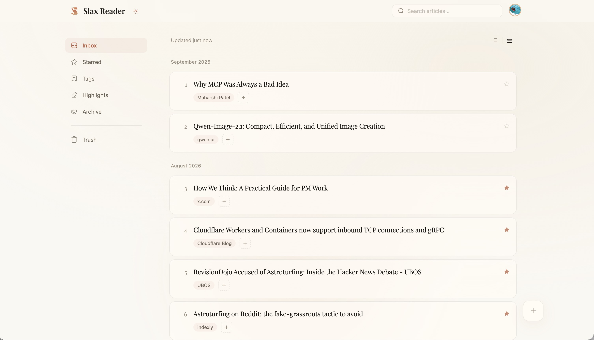

# Slax Reader

Open-source, AI-powered read-it-later — save web pages, highlight, and discuss.



## Get Slax Reader

- **Website**: [slax.com/reader](https://slax.com/reader/)
- **Web**: [r.slax.com](https://r.slax.com/)
- **iOS**: [App Store](https://apps.apple.com/us/app/slax-reader-ai-read-later/id6596730998)
- **Android**: [Google Play](https://play.google.com/store/apps/details?id=com.slax.reader)
- **Chrome Extension**: [Chrome Web Store](https://chromewebstore.google.com/detail/slax-reader/gdnhaajlomjkhahnmiijphnodkcfikfd) (works on Edge too)

Follow [@SlaxReader](https://x.com/SlaxReader) on X for updates.

## What it does

- **Save from anywhere**: the web app, the browser extension, the iOS and Android apps (including the system share sheet), Telegram, or the [command-line client](apps/cli/README.md), which AI agents can drive too.
- **Permanent snapshots**: saved pages stay readable even after the original link dies. Posts from X and Toutiao, YouTube videos, podcast episodes and uploaded PDFs become readable articles too.
- **AI reading aids**: outlines, summaries and in-context answers while you read, plus semantic search and related-content suggestions across your library.
- **Highlight and discuss**: annotate any passage, then share the page; anyone with the link can join the discussion.
- **Collections**: group bookmarks into public collections that others can follow from their Inbox; starred items can be shared as a collection.
- **Bring your library**: import from Pocket and Omnivore, and organize everything with tags.
- **Local-first mobile**: the apps keep your library on device and sync it in the background, so reading and search work offline.
- **Labs**: opt-in features such as RSS/Atom feeds, YouTube AI articles with translated captions, podcast transcripts and PDF bookmarks can be turned on in Settings → Labs.

## Repository structure

This monorepo hosts all Slax Reader code:

| Path                      | Description                                                         |
| ------------------------- | ------------------------------------------------------------------- |
| `apps/web`                | Web frontend ([r.slax.com](https://r.slax.com/))                    |
| `apps/extension`          | Browser extension (Chrome/Edge)                                     |
| `apps/mobile`             | Expo / React Native Android and iOS app (local-first, PowerSync)    |
| `apps/api`                | API server (Cloudflare Workers: Core, Edge, AI and Browser)         |
| `apps/cli`                | Command-line client                                                 |
| `packages/contracts`      | Shared API, domain and event contracts (`@slax-reader/contracts`)   |
| `packages/frontend-types` | Shared Web/Extension implementation types                           |
| `packages/frontend-utils` | Shared frontend utilities                                           |
| `packages/reader-embed`   | Portable reader assets and PDF runtime for mobile hosts             |
| `packages/selection`      | Shared highlighting and annotation engine                           |
| `deploy/`                 | Public API template, local infrastructure and mobile build inputs   |
| `docs/`                   | Development, deployment, CI and branching docs for every app        |
| `openspec/`               | OpenSpec specs and change proposals that describe product behaviour |
| `tests/e2e`               | End-to-end tests                                                    |
| `tooling/`                | Command dispatchers and repository tooling                          |

Shared libraries belong in `packages` when at least two apps use them. See the
[Web architecture](docs/web/architecture.md) for the current application and package boundaries.

## Development and self-hosting

Install dependencies once from the repository root:

```bash
pnpm install --frozen-lockfile
```

The root exposes one dispatcher per application while each app keeps its concrete command list:

```bash
pnpm preflight
pnpm setup:all
pnpm api -- dev
pnpm web -- dev
pnpm extension -- dev
```

`pnpm preflight` checks the Node.js/pnpm runtime and the API, Web, and Extension module states without changing local files or services. After configuration is prepared, `pnpm setup:all` runs API setup, Web setup, and Extension setup in order. Run the three `dev` commands separately; setup never starts application servers.

The API's `setup` command prepares local dependencies and exits; `dev` starts Workers separately. Use `pnpm api -- setup` when only the API needs to be initialized again. Remote deployment and migrations remain explicit operations with their safety checks. See the [API development guide](docs/api/DEVELOPMENT-DOCUMENT-EN.md) ([中文](docs/api/DEVELOPMENT-DOCUMENT-CN.md), [日本語](docs/api/DEVELOPMENT-DOCUMENT-JP.md)).

For a full walkthrough from a fresh checkout, follow [Local development setup](docs/LOCAL-SETUP.md). To run your own instance, the API targets Cloudflare Workers; see [Self-hosting](docs/api/SELF-HOSTING-EN.md) and the [Cloudflare deployment guide](docs/api/CLOUDFLARE-DEPLOY-EN.md) ([中文](docs/api/CLOUDFLARE-DEPLOY-CN.md), [日本語](docs/api/CLOUDFLARE-DEPLOY-JP.md)). Local Docker Compose provides PostgreSQL and PowerSync for development; it is not a containerized API runtime.

Preflight distinguishes startup blockers (`当前无法启动`) from missing functionality (`可启动，但无法正常运行`), such as unavailable Docker or missing login settings. Both return exit code 1; optional features do not. See [Reading preflight results](docs/LOCAL-SETUP.md#reading-preflight-results) for status meanings and recovery steps.

Web and Extension configuration lives alongside the API's under `deploy/local/`, distinguished by filename: `.env.web`/`.env.web.example` for Web, `.env.extension`/`.env.extension.example` for Extension. The API uses the public template [`deploy/cloudflare/api.toml.example`](deploy/cloudflare/api.toml.example) and ignored local configuration under `deploy/local/`. Secrets belong in ignored local environment files or platform secret stores; do not put them in tracked templates or browser bundles.

API commands and API-specific configuration belong to [`apps/api/`](apps/api/), including Prisma configs under `prisma/` and deployment code under `script/deploy/`. The root `api` command forwards to the scripts declared by `apps/api/package.json`. Validation commands include:

```bash
pnpm api -- gen:all
pnpm api -- lint
pnpm api -- typecheck
pnpm api -- test
pnpm api -- build
```

Shared HTTP types live in [`packages/contracts`](packages/contracts/README.md). Web, Extension, API and CLI code import the contract package and do not import application internals.

### Mobile

The Expo app in [`apps/mobile`](apps/mobile/) has its own dispatcher. Checks and JavaScript bundles need no production account:

```bash
pnpm mobile -- help
pnpm mobile -- check
pnpm mobile -- bundle
```

Native development builds need the Android SDK/JDK, or macOS with Xcode and CocoaPods for iOS, and read local build inputs from the ignored `deploy/mobile/` files:

```bash
pnpm mobile -- prebuild:clean --platform ios
pnpm mobile -- pods
pnpm mobile -- ios
pnpm mobile -- dev
```

The app supports Android 8.0 (API 26) and iOS 16.4 or later. See [Mobile development](docs/mobile/README.md), [mobile architecture](docs/mobile/architecture.md) and the [mobile build-input layout](deploy/mobile/README.md).

### CLI

The [CLI](apps/cli/README.md) is published as `@slax-lab/reader-cli` with the `reader-cli` executable. It needs no local deployment configuration to build or test:

```bash
pnpm cli -- typecheck
pnpm cli -- build
pnpm cli -- start --help
pnpm cli -- test
pnpm cli -- test:package
pnpm test:cli-tooling
```

See [CLI development](docs/cli/DEVELOPMENT.md) and [automated npm/GitHub releases](docs/cli/RELEASE.md). Merges that change the CLI and increase its package version automatically create `cli-v<version>-dev` and `cli-v<version>-beta` GitHub Pre-Releases on `dev` and `beta`. Promotion to `main` creates `cli-v<version>` and publishes the same tested stable archive through npm OIDC and GitHub Release; no user-added Actions secret is required.

## Contributing

Bug reports, features, and docs are all welcome. You can contribute without a development environment through
[Web 开发与参与指南](docs/web/development.md) or [Extension development](docs/extension/development.md).
See also the [contribution guidelines](docs/api/HOW-TO-CONTRIBUTION-EN.md) and our [Code of Conduct](CODE_OF_CONDUCT.md).

`dev` is the default branch. Cut a task branch such as `fix/short-name` from `dev` and open the pull request against `dev`; changes are promoted to `beta` and then `main` for release. Pull requests from forks are welcome. Behaviour changes are described as [OpenSpec](openspec/) changes, and CI runs only the app suites a change touches. See [Branching](docs/BRANCHING.md), [CI](docs/CI.md) and [Definition of done](docs/DEFINITION-OF-DONE.md) for details.

## License

[Apache License 2.0](LICENSE). Copyright is held by The Slax Reader Contributors — see [NOTICE](NOTICE) for details.
