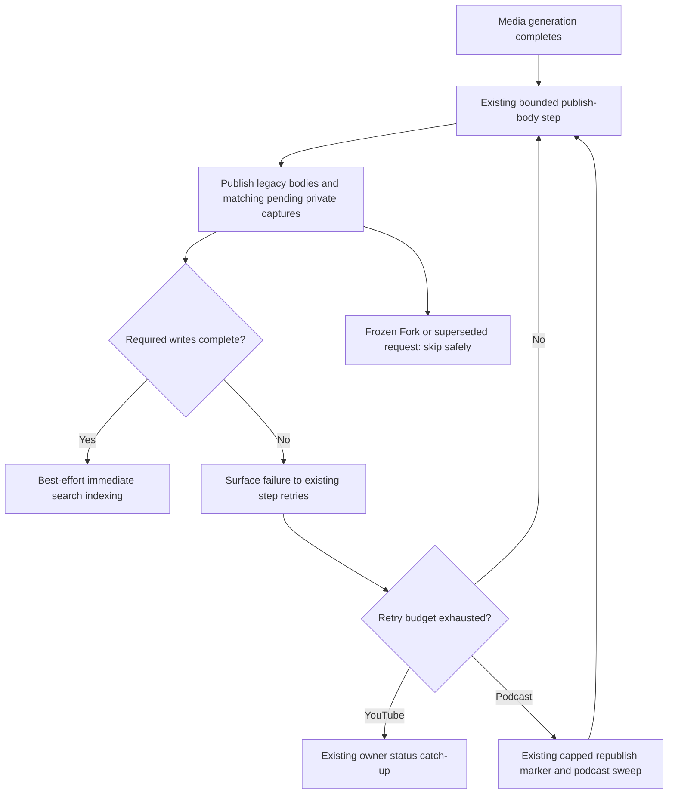
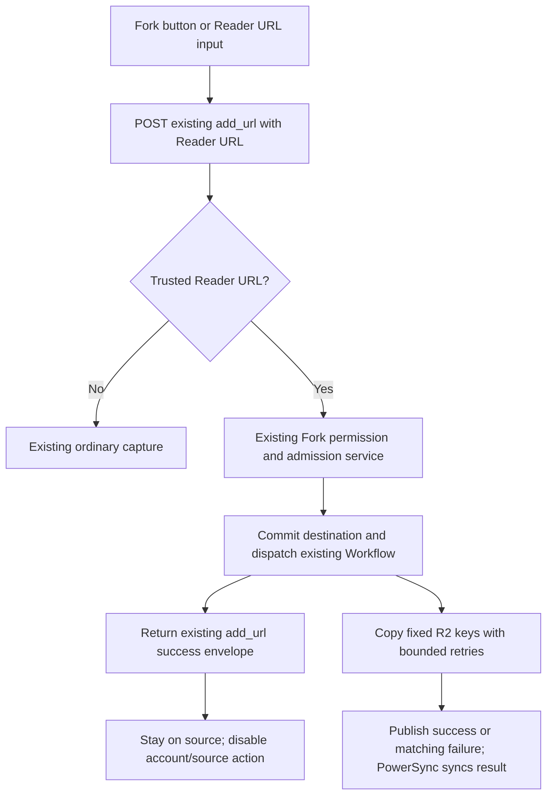
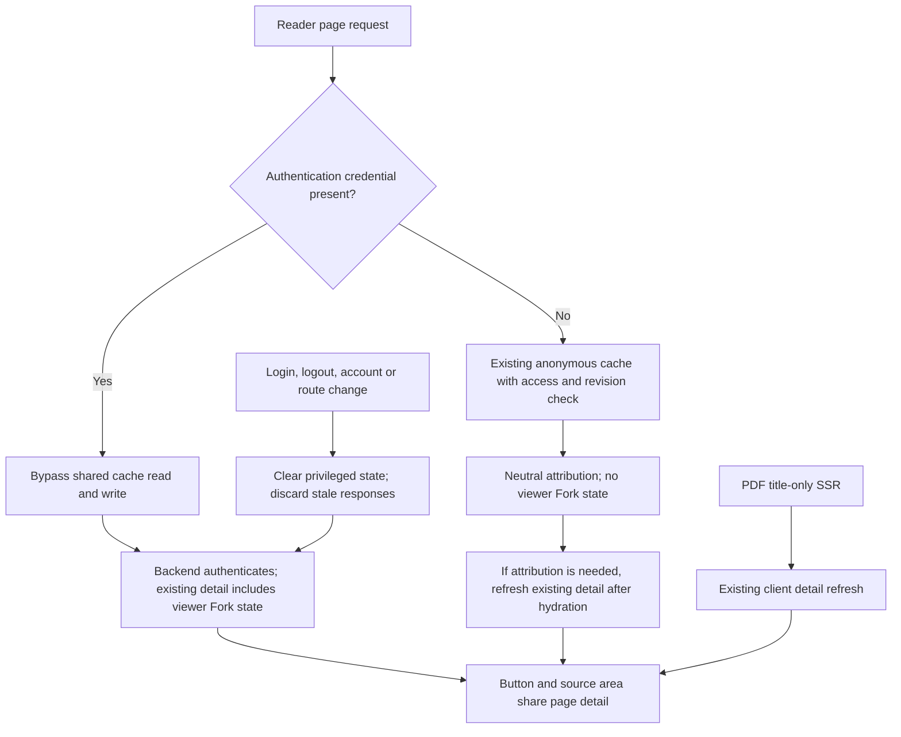
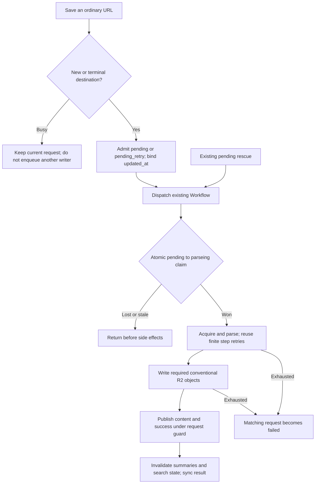
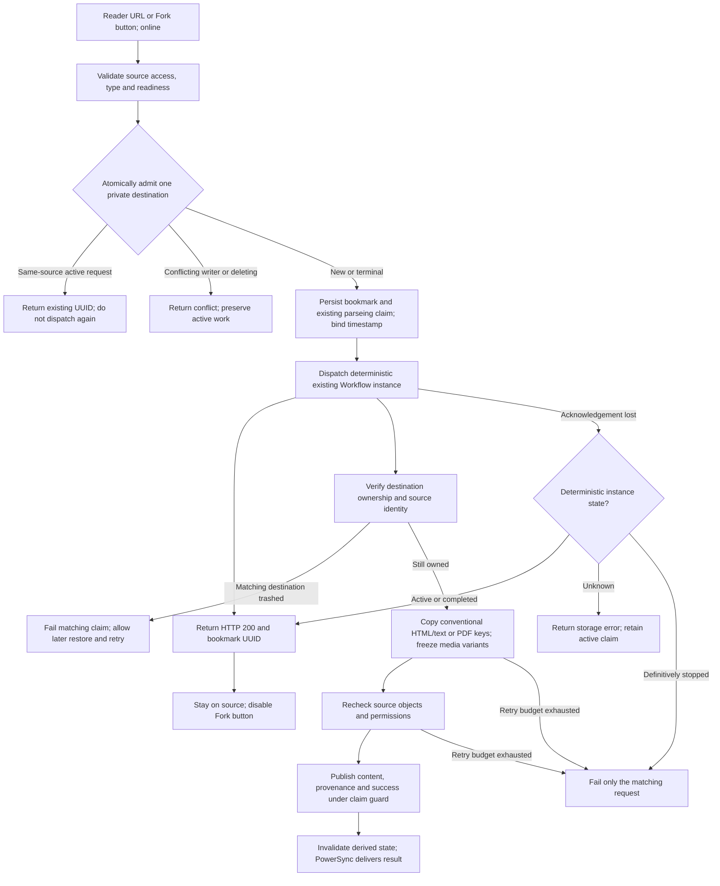
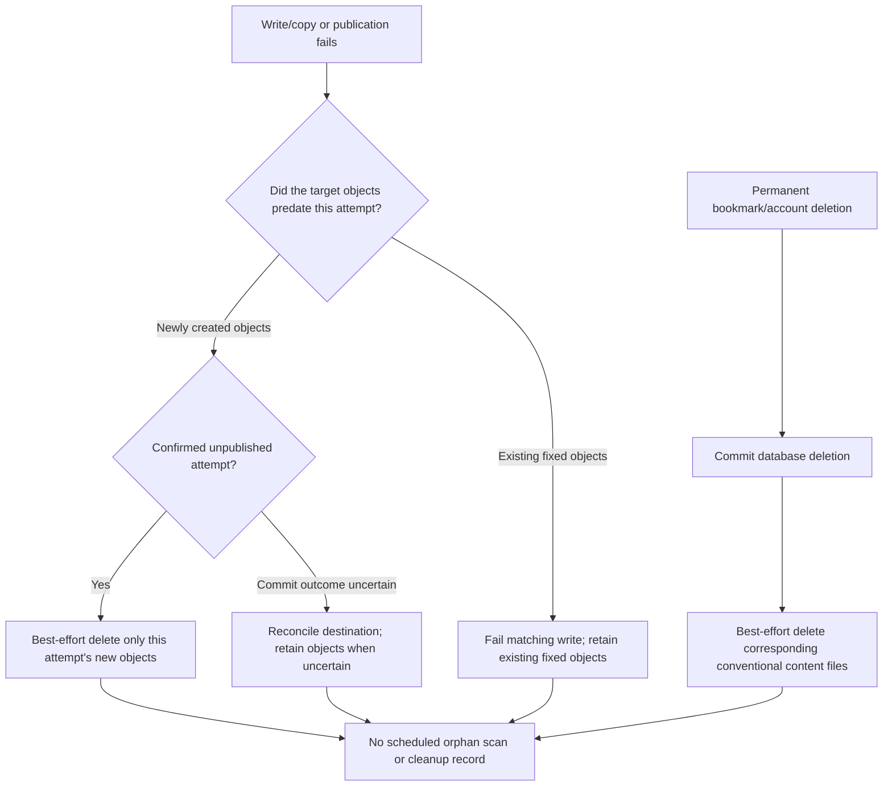

# Bookmark Fork: proposed simplification

**Status: plan for owner review, not implemented (2026-10-23, Asia/Shanghai).** Application baseline: `af32ec74` (application code unchanged since `5b0f503c`). The owner requested a reviewed plan and PR/report update before deciding whether to implement. The existing implementation report follows this proposal. Existing acceptance and CI results apply to that baseline, not to the proposed changes below. Do not merge as though this simplification has shipped.

## Proposed scope

Remove the added snapshot maintenance schedule, use `POST /v1/bookmark/add_url` for the Fork button, and return Fork attribution/viewer state through existing detail queries. Keep fixed R2 keys, one nullable provenance column, all six formats, asynchronous admission, repeat-URL refresh, finite retries, write exclusion and source authorization. No new table, version field, lease, background scan or general recovery framework.

## 1. Remove maintenance; preserve original recovery

Comparison with `dev` at `18f0dd6c`:

| Failure | Original behavior | Proposed behavior |
| --- | --- | --- |
| Ordinary save: search/embedding fails after content success | Log/track/alert; no general repair scan | Keep immediate indexing and existing failure reporting; no scheduled repair |
| Media body: indexing fails | Log failed parts; body remains saved | Same best-effort boundary; never fail a completed copy solely for indexing |
| YouTube body publication fails | Finite `publish-body` step retries, then owner status catch-up | Reuse those same triggers for matching pending private captures |
| Podcast body publication fails | Finite step retries, then `markRepublish`/`listRepublish` through the existing podcast sweep, with its existing cap | Preserve that recovery for legacy and matching pending private captures |
| Fork copy fails | Existing bounded Crawl Workflow execution | Retain it; no source-generation subscription and no new periodic rescue |

Delete `SnapshotMaintenanceJob`, `SnapshotMaintenanceService`, `BookmarkForkRepo.listSnapshots`, the maintenance cursor and their generated registrations. Remove the periodic index-repair role and `snapshot-index:*` KV markers. Keep a narrow immediate indexing operation using the existing search services, including user-search relation updates and existing deletion/concurrent-update safeguards. Do not remove successful-copy indexing, cache invalidation or summary invalidation with the scheduler. Old KV marker values need no migration or scanning cleanup.

**Retry correctness is a required implementation checkpoint.** Current `settleSource()` and per-reference publishers catch write failures; this can prevent `publish-body` retries and podcast republish from observing them. Process independent references, then surface genuine incomplete publication to the existing bounded caller. Deleted, superseded, frozen or input-mismatched references must not create endless retries. Status reads retain their existing non-throwing behavior. Do not classify a required write failure as successful merely because another reference succeeded.

Also verify claim lifecycle, not just exception propagation: `writeRevision()` currently changes its matching claim to `failed`, while ordinary settlement claims only `success`. A later retry must demonstrably recover the same eligible pending capture through existing ownership checks. Do not globally admit all failed bookmarks or allow a stale media publisher to replace a new owner capture. The implementation must prove transient write failure -> retry -> publication for the same request, and stale/newer-owner requests remaining excluded. If this requires a new persistent state, lease or recovery subsystem, stop and revisit the plan instead of expanding scope. A partial fixed-key write still has the accepted no-rollback limitation.

Frozen Forks remain excluded from media catch-up. Existing canonical-media retention, recycle-bin/account deletion and ordinary pending rescue jobs retain their original purposes. Immediate best-effort file deletion on permanent removal remains; no orphan reclamation is reintroduced.



## 2. One public save endpoint

The Fork button and online Reader URL dialog submit the existing request:

```json
{"target_url":"https://<configured-reader-origin>/b/<source-uuid>","tags":[]}
```

Use `POST /v1/bookmark/add_url`; preserve its success envelope and `{ "bmId": "" }` data convention. HTTP/envelope success means the bookmark was admitted and the durable Workflow accepted dispatch, not that R2 transfer completed. Keep the existing special handling of uncertain dispatch. No new response UUID is needed because the page does not navigate. Keep `bookmark_uid`/disposition in internal domain results where import, callbacks or other internal callers still require them; remove only unused public command types after checking consumers.

The existing Reader URL classifier calls the same Fork domain service before normal URL crawling. Construct the Reader URL from a configured trusted origin plus the source UUID, not the original website URL. Preserve the ordinary external-URL local-first path, Extension `/add`, Telegram/import actual-completion accounting and old queued-client compatibility. Keep existing `add_url` response/error conventions; preserve meaningful source/permission/busy/Labs failures without globally rewriting HTTP error behavior. A failed response envelope must never be treated as admission success.

Remove the unpublished `/fork` route and its public request/response-only plumbing after every repository caller is migrated. The dedicated controller can disappear after its metadata route is also moved. Regenerate routes/DI; do not hand-edit generated files. API-first deployment is still required. If a dedicated route has reached an external deployed consumer before implementation, reassess a temporary compatibility alias rather than silently breaking that consumer; no external deployment is claimed by this task.

Keep a small account/source request guard. A button is disabled for a pending request or persisted pending/success Fork, but explicit Add URL submission can refresh a completed copy. On acceptance, optimistically disable only this account/source action; refresh the existing detail query once. A refresh failure must not turn the accepted save into a failed submission. No new polling loop or persistent client queue. Discard stale responses after account/route changes and preserve the request-versus-background-completion distinction.



## 3. Detail data and cache isolation

Reuse `ContentOrchestrator.getContentMeta()` (`/content/meta` through Web `/api/content/<uuid>`) for public Reader details, and `BookmarkOrchestrator.bookmarkDetail()` for authenticated legacy/private-detail consumers. Return the existing `has_fork`, safe `fork` projection and `viewer_fork_status` as additive detail fields; remove the unused `can_fork` field if consumer search confirms it has no remaining use. Reuse one projection helper with the already-authorized destination relation, avoiding a duplicate destination lookup. Reauthorize the exact source integer relation and preserve identity visibility, resource consistency and unavailable-source behavior. Never trust client-supplied provenance or a decoded JWT for authorization.

Remove `/fork_metadata`, its anonymous auth exception and its separate component fetches. The button and attribution consume the same detail result. An ordinary non-Fork detail with no relevant signed-in visitor should not issue an unnecessary provenance/status query. Private details need attribution but not a viewer-copy lookup for their owner.

| Request | Shared HTML cache | Detail state |
| --- | --- | --- |
| No authentication credential | Anonymous visitor cache only | `viewer_fork_status = null`; viewer-independent neutral Fork marker |
| Token cookie or supported authorization header present, including invalid/expired credentials | Bypass both cache lookup and cache storage; `private, no-store` | Backend-authenticated viewer projection; invalid auth cannot acquire privileged data |
| Client login/logout/account switch | Invalidate account-specific detail state before refresh | Ignore old account responses; refresh existing detail route |
| PDF SSR | Preserve title/type-only hydration payload | Existing client detail refresh loads descriptor, attribution and viewer status |

The cache bypass must cover both the early-hit middleware and the render/store plugin, including raw credential presence rather than a successful client-side JWT parse. Preserve backend permission/revision revalidation for anonymous cached pages and existing moderation checks. Do not introduce per-user edge cache keys. Authenticated detail responses/proxies must not become publicly cacheable.

Keep anonymous SSR Fork attribution neutral, as today. After hydration, load permitted attribution through the existing detail route only when needed, once at page level; do not embed a source-owner-only name/link into shared HTML. Logged-in HTML details can use their uncached SSR result. PDF details reuse the existing post-hydration refresh rather than serializing private descriptors or adding a new request. Account changes clear old attribution immediately, including while offline; suppress actions until the relevant authenticated detail is available. Key or invalidate Nuxt detail state by route and account/session generation, not only `content-<uuid>`. Do not serialize an auth token into state/cache keys. Include REST detail, local-first overlays and SPA navigation in the consumer audit so a separately rendered article never loses attribution.

The deliberate tradeoff is fewer specialized interfaces, at the cost of bypassing shared SSR cache for authenticated page requests. Anonymous traffic keeps its current cache. A single existing detail refresh may include body data; do not add a new metadata-only transport merely to optimize that before measurement.



## 4. Further reductions and retained safeguards

| Area | Planned action | Reason |
| --- | --- | --- |
| Snapshot maintenance service/job/cursor and scan tests | Remove; retain regression tests proving no new scheduler is registered | Original retry triggers are sufficient for the selected reliability boundary |
| Dedicated Fork controller, route-generator entry, metadata auth exception and route-specific headers | Remove after endpoint migration; retain headers where existing details need privacy | Reuse save and detail interfaces |
| `useBookmarkForkMetadata`, component-local duplicate reads, unused `can_fork` and public-only command types | Remove/consolidate into detail state | One source of viewer/attribution state |
| `repairIndex` marker/revision cache | Reduce to immediate indexing; remove KV-only marker deletion | No scheduled retry guarantee; keep necessary search updates |
| Unused `retiredKey` return/destructure | Remove if remaining caller audit confirms no use | Fixed-key replacement has no retired bundle |
| Unrelated formatting and comments describing deleted cleanup/recovery | Revert or correct only within this PR | Reduce review noise without a formatting sweep |
| Fixed-key `SnapshotBundle` attempt/staging-shaped arguments | Remove only proven inert parameters/branches after call-site audit | Keep source ETag checks, metadata allowlists and failure ownership; no helper rewrite for aesthetics |
| Atomic admission, accepted timestamps, stale-write guards and source checks | Keep | Necessary because updates reuse the same R2 keys |
| Media input/variant freezing, policy references, PDF identity and legacy adapters | Keep | Required by all-format independence and existing access/moderation behavior |
| Local-only Workflow test launcher and meaningful tests | Keep | Needed to exercise real asynchronous behavior; do not chase a lower file count |
| Immediate permanent-delete file removal | Keep narrow | Requested lifecycle behavior, unrelated to periodic scanning |

Do not merge services merely to reduce file count, remove old-client compatibility, replace fixed keys, redesign canonical media generation or add provider dependencies. Preserve the settled no-version-bump decision. Reassess only if implementation introduces a new affected app beyond the agreed scope.

## 5. File-count audit

Git rename-aware comparison: initial implementation `a1be9217` versus current `af32ec74`, each against its `origin/dev` merge base. This is the implementation baseline, not a prediction for this documentation-only planning update.

| Category | Initial | Current | Change |
| --- | ---: | ---: | ---: |
| API implementation/config/schema | 35 | 44 | +9 |
| API generated files | 3 | 3 | 0 |
| Web implementation/locales | 16 | 19 | +3 |
| Extension implementation | 1 | 2 | +1 |
| Shared contracts | 2 | 2 | 0 |
| Tests across apps | 46 | 63 | +17 |
| Documentation/OpenSpec | 28 | 29 | +1 |
| Total | 131 | 162 | +31 |

The 17 media-archive dependency files from PR #353 were already in the initial count. Later additions came from media recovery (+6 files), independent-recapture provenance (+2), cleanup addition/removal (+1 net), fixed-path/concurrency/frontend guards (+19), asynchronous runtime launcher coverage (+2), and permission regression coverage (+1). Production/config changes grew by 13 files; testing does not explain all growth. This proposal removes redundant production paths while preserving meaningful tests. Exact final counts will be measured after implementation; detail/type/cache integration may touch existing files not currently in the diff, so a promised absolute file-count reduction would be misleading.

## 6. Plan review and implementation acceptance

Reviewed under `REVIEW.md` Bugs, Security and Compliance passes; change-id `add-bookmark-fork`. This is a code-informed plan review, not a new runtime verification or an independent subagent review.

| Review issue | Required resolution in the plan |
| --- | --- |
| Removing the job while swallowing publication errors disables original retries | Propagate genuine publish failures; test legacy/private retries and claim lifecycle, including retry after a matching failed write |
| Reusing add_url can accidentally require its empty `bmId`, lose error meaning, or confuse refresh with a disabled button | Preserve existing response shape; use admission success only, preserve deliberate Reader-URL refresh and error handling |
| Personalized SSR can leak through an early cache hit, render cache write or stale Nuxt state | Bypass both authenticated cache paths, retain neutral anonymous SSR, clear account state and reject stale responses |
| PDF title-only SSR and shared article consumers could lose Fork UI | Reuse client PDF refresh and both existing detail projections; test all formats and private/public consumers |
| Plans could be reported as shipped | Keep normative specs and prior acceptance as baseline until approval; proposed tasks remain unchecked; PR explicitly awaits a construction decision |

These risks have concrete controls in the proposed design; runtime proof remains required before completion. Implement only after the owner approves construction. Then reconcile the existing delta specs: remove the maintenance requirement/scenario, replace the public UUID/disposition response requirement with the add_url acknowledgement, and add detail/cache/account/PDF scenarios. Keep media and no-rollback semantics intact.

Acceptance before marking the simplification complete:

- No maintenance registration, R2 inventory scan, new repair table, cursor or recurring snapshot-index work.
- Inject transient media body failures: original Workflow retries recover; exhausted podcast publication reaches its existing capped republish; owner status catch-up remains; frozen and completed unrelated captures are not changed. Verify claim status/timestamp behavior with a real database, including concurrent owner refresh.
- Inject search failures after successful content publication: content and provenance remain successful; log/alert as applicable; no periodic retry is scheduled.
- Exercise real add_url admission/copy for HTML, shortcut, uploaded/downloaded PDF, YouTube and podcast; duplicate clicks, failed source, failed dispatch, offline entry, ordinary URL regression, and explicit same-UUID refresh. No client calls the deleted endpoints.
- Exercise anonymous -> user A -> user B -> logout, source-owner privileged attribution -> anonymous, stale responses, invalid credentials, source revocation, cache hit/store and SPA transitions. Assert both response contents and cache behavior; credentials must not enter logs or serialized keys.
- Preserve PDF title-only SSR and verify its existing client refresh supplies Fork state/attribution. One page-owned projection supplies both components without duplicate metadata fetches.
- Keep focused tests plus API/Web typecheck/build, affected integration/runtime and UI checks, strict OpenSpec validation and all review passes. Obtain renewed hands-on acceptance for changed UI data flow; earlier acceptance is not a claim of testing this future implementation. Record precise gaps instead of fabricating coverage.

---

# Existing implementation baseline: fixed paths

This is the current implementation summary for OpenSpec `add-bookmark-fork` (2026-10-23). It supersedes the earlier immutable-path and repeated-Fork no-op design. The original nullable `sr_user_bookmark.forked_from_id` remains; this follow-up adds no database columns, tables, content counters, or version history.

## Behavior

- New captures are private. Another owner's capture or media generation cannot replace a completed private body or its ready translations.
- Reader URL saves and the online Fork button invoke the same copy operation. Supported types include articles, shortcuts, uploaded/downloaded PDFs, YouTube, and podcasts.
- An accepted repeat Fork refreshes the existing destination and provenance. Its user-bookmark ID/UUID, tags, marks, notes, alias, star and archive state remain. A busy destination rejects another writer; initial concurrent creates use the existing unique resource identity and cannot insert two destinations.
- Explicit resaving of a historical shared article converts only that user's relation to a private raw row. The relation keeps its ID/UUID. A fresh storage UUID avoids overwriting the shared object; directory and filename conventions stay unchanged. There is no bulk historical migration.
- Ordinary captures keep their acquire/parse, required-file writes, database publication order. Existing finite Workflow retries remain. Interactive Fork acknowledges the persisted bookmark immediately and copies through the existing background Workflow with finite retries. Internal import/Telegram completion adapters retain actual-completion accounting.

## Entry points and persistence

| Entry point | Result |
| --- | --- |
| Web Fork button | Authenticated online admission; HTTP 200 after dispatch; stays on the source |
| Web Add URL with a trusted Reader `/b/<UUID>` | Same admission; explicit resubmission can refresh a completed copy |
| Extension `/add` and direct `/add_url` | Classify the trusted Reader URL before HTML parsing; ignore Reader-shell HTML |
| Import and Telegram callback adapters | Reuse the completed-copy adapter so per-item/callback accounting still reflects real completion |
| Ordinary external URL | Existing capture pipeline with private destination/write isolation |

`POST /v1/bookmark/fork` accepts `source_user_bookmark_uuid` and returns the existing `{code, message, data}` envelope; data contains `bookmark_uid` and `disposition` (`created`, `updated`, or `already_saved`). HTTP 200 means acceptance, not readable content. Invalid/inaccessible/unready sources and disabled acquisition features are rejected before destination admission.

`GET /v1/bookmark/fork_metadata?bookmark_uid=...` retains source attribution and adds optional viewer-only `viewer_fork_status`. Responses remain `private, no-store`; account/route changes discard stale frontend responses. `pending` covers an active same-resource save, `success` requires exact Fork provenance, `failed` permits retry, and no live matching copy yields null.

The only feature migration adds nullable `sr_user_bookmark.forked_from_id`, pointing to the immediate source user-bookmark ID. It has no cascading foreign key and no JSON provenance mirror. Existing `(target_url, private_user)` uniqueness decides resource ownership. Existing status and `updated_at` bind an accepted write; the timestamp is not a user-visible revision counter. No cleanup table or extra state/version column is added.

Private ownership isolates writes; it does not replace existing sharing/access policy. Attribution is resolved against current source access and identity-display preferences. Source removal or access revocation hides attribution details while leaving a completed independent copy readable. Fork does not copy the source owner's notes, marks, tags or private AI state.

## Storage

| Content | Conventional key |
| --- | --- |
| HTML | `html/body/<UUID>.html` |
| Article text | `text/body/<UUID>.txt` |
| PDF binary | `pdf/body/<UUID>.pdf` |
| PDF extraction state | `pdf/meta/<UUID>.json` |
| PDF text | `text/pdf/<UUID>.txt` |

No new `snapshots/`, `forks/`, or attempt directories are written. Private media variants, cues and input identity live in an inert JSON data block inside the HTML; the relational Fork mapping does not live in that block. Existing descriptor and player behavior are reused. External video/audio/image URLs retain their existing availability limits.

## Admission and existing retries

A new or deliberately repeated ordinary save admits one request into `pending`/`pending_retry`. Busy saves leave its input and timestamp untouched. The accepted existing `updated_at` is carried with the task; it identifies that request without adding a content-version field.

A Workflow claims `pending`/`pending_retry` to `parseing` once in a durable step. One SQL `UPDATE` keeps the status/time predicate on the target row; this matters because the relational Prisma update observed in PostgreSQL testing admitted two concurrent claimants. Duplicate workflows return before fetching or writing. Retries within the owning Workflow retain its claim. Terminal success advances the timestamp monotonically, and terminal failure changes only the matching request.

Rescue schedules eligible pending work without first changing it to failed. It does not steal `parseing`. Native PDF upload, private media publication and legacy media-body publication use the same exclusion boundary. The still-registered old third-party queue drains through the guarded Workflow. Historical cached-content short circuits release their claim to success.



## Fork and R2 lifecycle

The server checks source access, resolved-format feature gates and readiness, then atomically reserves the destination with the existing active-write status. After dispatching the existing Workflow it returns HTTP 200 with the destination UUID; it does not wait for any R2 copy. A deterministic instance of the existing Workflow performs the copy with bounded retries, validates source object ETags and source database identity/access again, then publishes content success. The acceptance timestamp fences stale executions without a new version field. Existing content keeps its old provenance until successful publication. HTML text is derived from the same captured HTML. PDF bytes, extraction descriptor and ready text are copied together. Media copy freezes the available variants/cues without starting provider generation.






Admission race losers never overwrite the winning UUID. A new interactive destination exists before copying, so a failed copy remains a removable/retryable failed bookmark rather than disappearing. Update failures never delete the live destination's fixed files. No retired bundle deletion occurs after a successful replacement. Existing bounded media settlement/index repair remains, but it does not inventory R2 or reclaim orphan files.

## Boundaries and validation

Historical shared conversion reserves a new private content key before the first copy. If dispatch or copying fails, that user may temporarily lose readable content through the preserved relation until a retry succeeds; the former shared object and other owners remain intact. This availability tradeoff is not a promise of rollback.

Fixed-key replacement is not an atomic transaction across R2 and PostgreSQL. Failure can leave partially replaced files; it reports failure and does not promise rollback to the old body. A process exit after claiming `parseing`, or an unresolved dispatch acknowledgement, can leave that state stuck; no timeout takeover or new recovery subsystem is added. Failed deletion and uncertain publication can retain files. These limits are deliberate scope choices.

Frontend guards cover in-flight requests and currently synced pending states. The Fork action stays on the source after HTTP acceptance, without automatic navigation. Fresh no-store metadata provides the viewer’s Fork status on every visit: active or successful copies disable the button; failed or deleted copies permit explicit retry. The viewed article’s own Fork attribution is separate from this viewer-specific status. Request locks release on settlement and never retry automatically; account/route changes discard stale responses. Deliberate Reader-URL submission can still refresh a completed copy. The backend remains authoritative across devices and ambiguous network outcomes.

Verification and completed owner hands-on acceptance are recorded in [validation.md](../../openspec/changes/add-bookmark-fork/validation.md). Production deployment and real third-party provider execution are not claimed by local fixtures.

## Handoff and deployment

Apply the existing additive Fork-provenance migration before deploying the updated API. There is no R2 bulk move, filename conversion or historical content backfill. Drain old writers when deploying isolation changes so old and new ownership rules do not write concurrently. Legacy content continues to read its saved pointers; explicit recapture privatizes only the requesting user's historical shared relation.

The primary checkout uses `feat/add-bookmark-fork`. Start the API with `pnpm api -- dev` and Web with `pnpm web -- dev` from the repository root; setup and local migration were already completed for this checkout. Do not rerun destructive reset merely to test this follow-up.

The owner explicitly requested updating the existing PR before performing their new local hands-on test on 2026-10-23. The owner subsequently tested the primary local checkout on the same date and confirmed that the current implementation meets expectations, with no further UI/functional adjustments requested. The confirmation and remaining verification gaps are recorded in validation.md. No deployment or merge is part of this handoff.
