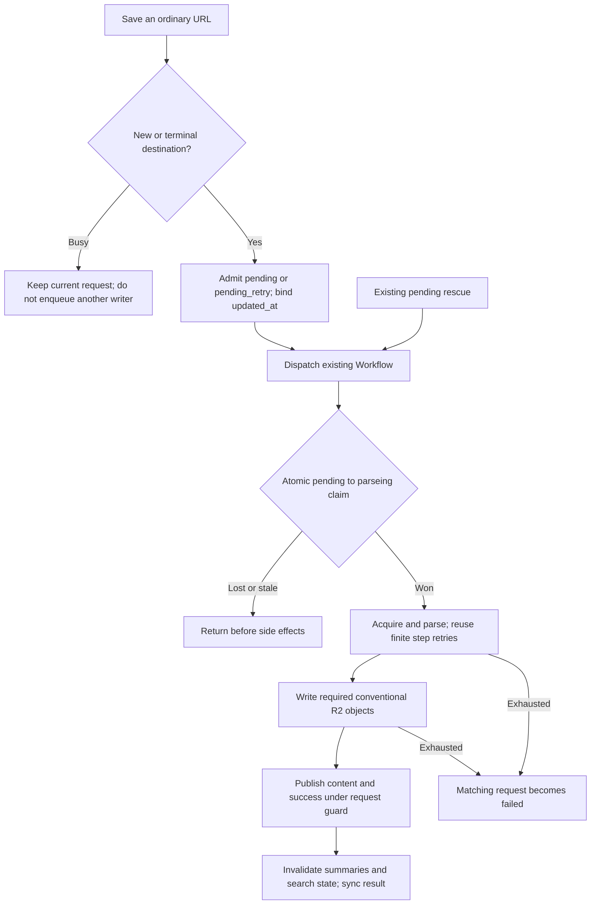
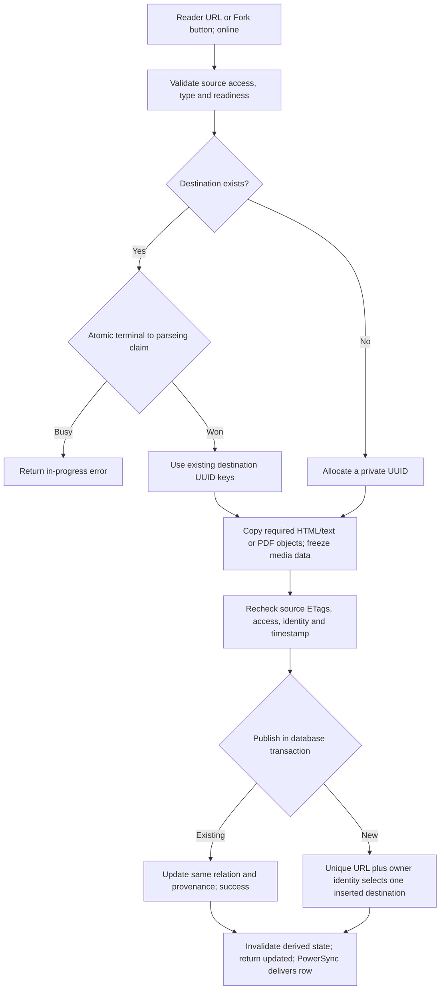
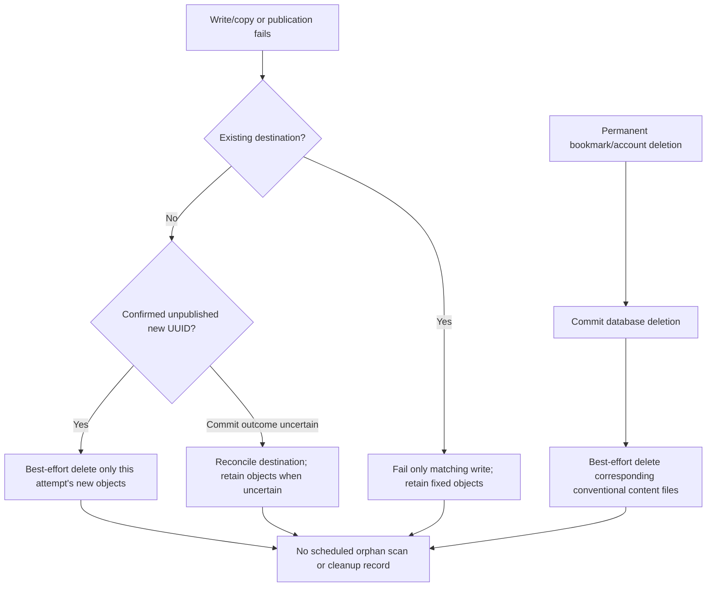

# Bookmark Fork: fixed-path implementation

This is the current implementation summary for OpenSpec `add-bookmark-fork` (2026-10-23). It supersedes the earlier immutable-path and repeated-Fork no-op design. The original nullable `sr_user_bookmark.forked_from_id` remains; this follow-up adds no database columns, tables, content counters, or version history.

## Behavior

- New captures are private. Another owner's capture or media generation cannot replace a completed private body or its ready translations.
- Reader URL saves and the online Fork button invoke the same copy operation. Supported types include articles, shortcuts, uploaded/downloaded PDFs, YouTube, and podcasts.
- An accepted repeat Fork refreshes the existing destination and provenance. Its user-bookmark ID/UUID, tags, marks, notes, alias, star and archive state remain. A busy destination rejects another writer; initial concurrent creates use the existing unique resource identity and cannot insert two destinations.
- Explicit resaving of a historical shared article converts only that user's relation to a private raw row. The relation keeps its ID/UUID. A fresh storage UUID avoids overwriting the shared object; directory and filename conventions stay unchanged. There is no bulk historical migration.
- Ordinary captures keep their acquire/parse, required-file writes, database publication order. Existing finite Workflow retries remain. Fork itself is a synchronous online copy, not a new background retry workflow; a failed request can be deliberately retried.

## Storage

| Content | Conventional key |
| --- | --- |
| HTML | `html/body/<UUID>.html` |
| Article text | `text/body/<UUID>.txt` |
| PDF binary | `pdf/body/<UUID>.pdf` |
| PDF extraction state | `pdf/meta/<UUID>.json` |
| PDF text | `text/pdf/<UUID>.txt` |

No new `snapshots/`, `forks/`, or attempt directories are written. Private media variants, cues and input identity live in an inert JSON data block inside the HTML; the relational Fork mapping does not live in that block. Existing descriptor and player behavior are reused. External video/audio/image URLs retain their existing availability limits.

## Admission and existing retries

A new or deliberately repeated ordinary save admits one request into `pending`/`pending_retry`. Busy saves leave its input and timestamp untouched. The accepted existing `updated_at` is carried with the task; it identifies that request without adding a content-version field.

A Workflow claims `pending`/`pending_retry` to `parseing` once in a durable step. One SQL `UPDATE` keeps the status/time predicate on the target row; this matters because the relational Prisma update observed in PostgreSQL testing admitted two concurrent claimants. Duplicate workflows return before fetching or writing. Retries within the owning Workflow retain its claim. Terminal success advances the timestamp monotonically, and terminal failure changes only the matching request.

Rescue schedules eligible pending work without first changing it to failed. It does not steal `parseing`. Native PDF upload, private media publication and legacy media-body publication use the same exclusion boundary. The still-registered old third-party queue drains through the guarded Workflow. Historical cached-content short circuits release their claim to success.

## Fork and R2 lifecycle

The server checks source access and readiness, copies required content, validates source object ETags and source database identity/access again, then publishes. HTML text is derived from the same captured HTML. PDF bytes, extraction descriptor and ready text are copied together. Media copy freezes the available variants/cues without starting provider generation.

Initial race losers never overwrite the winning UUID. Update failures never delete the live destination's fixed files. No retired bundle deletion occurs after a successful replacement. Existing bounded media settlement/index repair remains, but it does not inventory R2 or reclaim orphan files.

## Boundaries and validation

Fixed-key replacement is not an atomic transaction across R2 and PostgreSQL. Failure can leave partially replaced files; it reports failure and does not promise rollback to the old body. A process exit after claiming `parseing` can leave that state stuck; no timeout takeover or new recovery subsystem is added. Failed deletion and uncertain publication can retain files. These limits are deliberate scope choices.

Frontend guards cover in-flight requests and currently synced pending states. They always release local request locks on settlement and never retry automatically. The backend is authoritative across tabs, devices, delayed sync and ambiguous network outcomes. Changing accounts cancels stale submission/navigation intent.

Verification and the outstanding follow-up human UI acceptance are recorded in [validation.md](../../openspec/changes/add-bookmark-fork/validation.md). Production deployment and real third-party provider execution are not claimed by local fixtures.
