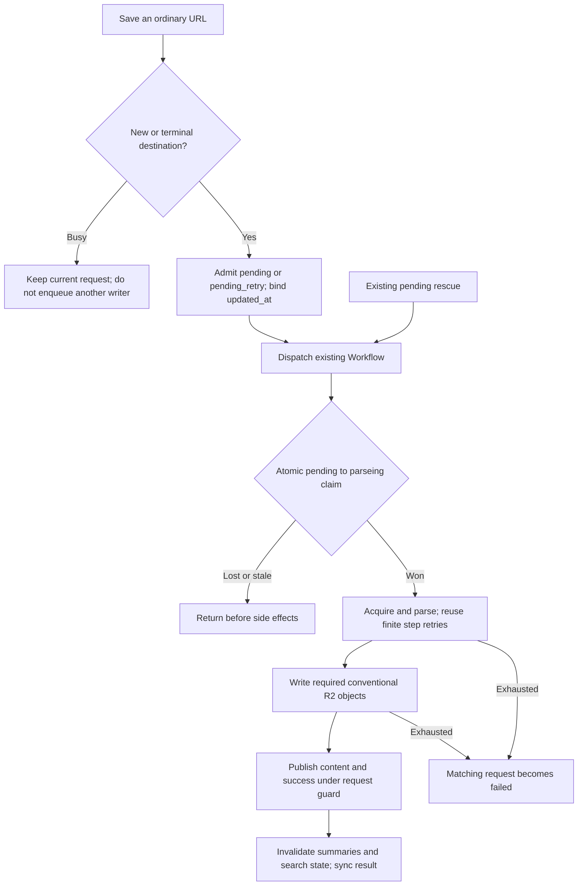
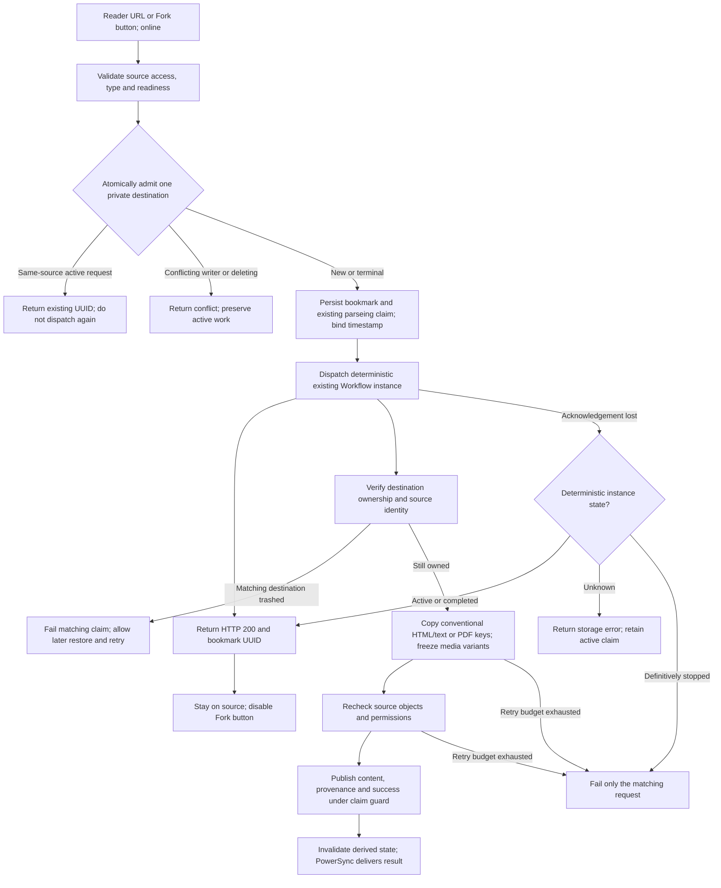
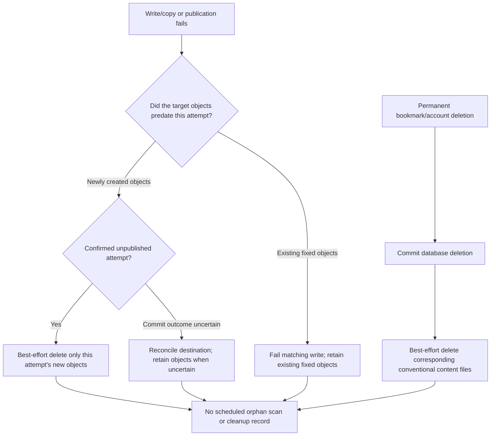

# Bookmark Fork: fixed-path implementation

This is the current implementation summary for OpenSpec `add-bookmark-fork` (2026-10-23). It supersedes the earlier immutable-path and repeated-Fork no-op design. The original nullable `sr_user_bookmark.forked_from_id` remains; this follow-up adds no database columns, tables, content counters, or version history.

## Behavior

- New captures are private. Another owner's capture or media generation cannot replace a completed private body or its ready translations.
- Reader URL saves and the online Fork button invoke the same copy operation. Supported types include articles, shortcuts, uploaded/downloaded PDFs, YouTube, and podcasts.
- An accepted repeat Fork refreshes the existing destination and provenance. Its user-bookmark ID/UUID, tags, marks, notes, alias, star and archive state remain. A busy destination rejects another writer; initial concurrent creates use the existing unique resource identity and cannot insert two destinations.
- Explicit resaving of a historical shared article converts only that user's relation to a private raw row. The relation keeps its ID/UUID. A fresh storage UUID avoids overwriting the shared object; directory and filename conventions stay unchanged. There is no bulk historical migration.
- Ordinary captures keep their acquire/parse, required-file writes, database publication order. Existing finite Workflow retries remain. Interactive Fork acknowledges the persisted bookmark immediately and copies through the existing background Workflow with finite retries. Internal import/Telegram completion adapters retain actual-completion accounting.

## Entry points and persistence

| Entry point | Result |
| --- | --- |
| Web Fork button | Authenticated online admission; HTTP 200 after dispatch; stays on the source |
| Web Add URL with a trusted Reader `/b/<UUID>` | Same admission; explicit resubmission can refresh a completed copy |
| Extension `/add` and direct `/add_url` | Classify the trusted Reader URL before HTML parsing; ignore Reader-shell HTML |
| Import and Telegram callback adapters | Reuse the completed-copy adapter so per-item/callback accounting still reflects real completion |
| Ordinary external URL | Existing capture pipeline with private destination/write isolation |

`POST /v1/bookmark/fork` accepts `source_user_bookmark_uuid` and returns the existing `{code, message, data}` envelope; data contains `bookmark_uid` and `disposition` (`created`, `updated`, or `already_saved`). HTTP 200 means acceptance, not readable content. Invalid/inaccessible/unready sources and disabled acquisition features are rejected before destination admission.

`GET /v1/bookmark/fork_metadata?bookmark_uid=...` retains source attribution and adds optional viewer-only `viewer_fork_status`. Responses remain `private, no-store`; account/route changes discard stale frontend responses. `pending` covers an active same-resource save, `success` requires exact Fork provenance, `failed` permits retry, and no live matching copy yields null.

The only feature migration adds nullable `sr_user_bookmark.forked_from_id`, pointing to the immediate source user-bookmark ID. It has no cascading foreign key and no JSON provenance mirror. Existing `(target_url, private_user)` uniqueness decides resource ownership. Existing status and `updated_at` bind an accepted write; the timestamp is not a user-visible revision counter. No cleanup table or extra state/version column is added.

Private ownership isolates writes; it does not replace existing sharing/access policy. Attribution is resolved against current source access and identity-display preferences. Source removal or access revocation hides attribution details while leaving a completed independent copy readable. Fork does not copy the source owner's notes, marks, tags or private AI state.

## Storage

| Content | Conventional key |
| --- | --- |
| HTML | `html/body/<UUID>.html` |
| Article text | `text/body/<UUID>.txt` |
| PDF binary | `pdf/body/<UUID>.pdf` |
| PDF extraction state | `pdf/meta/<UUID>.json` |
| PDF text | `text/pdf/<UUID>.txt` |

No new `snapshots/`, `forks/`, or attempt directories are written. Private media variants, cues and input identity live in an inert JSON data block inside the HTML; the relational Fork mapping does not live in that block. Existing descriptor and player behavior are reused. External video/audio/image URLs retain their existing availability limits.

## Admission and existing retries

A new or deliberately repeated ordinary save admits one request into `pending`/`pending_retry`. Busy saves leave its input and timestamp untouched. The accepted existing `updated_at` is carried with the task; it identifies that request without adding a content-version field.

A Workflow claims `pending`/`pending_retry` to `parseing` once in a durable step. One SQL `UPDATE` keeps the status/time predicate on the target row; this matters because the relational Prisma update observed in PostgreSQL testing admitted two concurrent claimants. Duplicate workflows return before fetching or writing. Retries within the owning Workflow retain its claim. Terminal success advances the timestamp monotonically, and terminal failure changes only the matching request.

Rescue schedules eligible pending work without first changing it to failed. It does not steal `parseing`. Native PDF upload, private media publication and legacy media-body publication use the same exclusion boundary. The still-registered old third-party queue drains through the guarded Workflow. Historical cached-content short circuits release their claim to success.

## Fork and R2 lifecycle

The server checks source access, resolved-format feature gates and readiness, then atomically reserves the destination with the existing active-write status. After dispatching the existing Workflow it returns HTTP 200 with the destination UUID; it does not wait for any R2 copy. A deterministic instance of the existing Workflow performs the copy with bounded retries, validates source object ETags and source database identity/access again, then publishes content success. The acceptance timestamp fences stale executions without a new version field. Existing content keeps its old provenance until successful publication. HTML text is derived from the same captured HTML. PDF bytes, extraction descriptor and ready text are copied together. Media copy freezes the available variants/cues without starting provider generation.

Admission race losers never overwrite the winning UUID. A new interactive destination exists before copying, so a failed copy remains a removable/retryable failed bookmark rather than disappearing. Update failures never delete the live destination's fixed files. No retired bundle deletion occurs after a successful replacement. Existing bounded media settlement/index repair remains, but it does not inventory R2 or reclaim orphan files.

## Boundaries and validation

Historical shared conversion reserves a new private content key before the first copy. If dispatch or copying fails, that user may temporarily lose readable content through the preserved relation until a retry succeeds; the former shared object and other owners remain intact. This availability tradeoff is not a promise of rollback.

Fixed-key replacement is not an atomic transaction across R2 and PostgreSQL. Failure can leave partially replaced files; it reports failure and does not promise rollback to the old body. A process exit after claiming `parseing`, or an unresolved dispatch acknowledgement, can leave that state stuck; no timeout takeover or new recovery subsystem is added. Failed deletion and uncertain publication can retain files. These limits are deliberate scope choices.

Frontend guards cover in-flight requests and currently synced pending states. The Fork action stays on the source after HTTP acceptance, without automatic navigation. Fresh no-store metadata provides the viewer’s Fork status on every visit: active or successful copies disable the button; failed or deleted copies permit explicit retry. The viewed article’s own Fork attribution is separate from this viewer-specific status. Request locks release on settlement and never retry automatically; account/route changes discard stale responses. Deliberate Reader-URL submission can still refresh a completed copy. The backend remains authoritative across devices and ambiguous network outcomes.

Verification and pending hands-on acceptance are recorded in [validation.md](../../openspec/changes/add-bookmark-fork/validation.md). Production deployment and real third-party provider execution are not claimed by local fixtures.

## Handoff and deployment

Apply the existing additive Fork-provenance migration before deploying the updated API. There is no R2 bulk move, filename conversion or historical content backfill. Drain old writers when deploying isolation changes so old and new ownership rules do not write concurrently. Legacy content continues to read its saved pointers; explicit recapture privatizes only the requesting user's historical shared relation.

The primary checkout uses `feat/add-bookmark-fork`. Start the API with `pnpm api -- dev` and Web with `pnpm web -- dev` from the repository root; setup and local migration were already completed for this checkout. Do not rerun destructive reset merely to test this follow-up.

The owner explicitly requested updating the existing PR before performing their new local hands-on test on 2026-10-23. This changes the usual acceptance order for this handoff; it does not constitute acceptance. Check no-navigation, duplicate clicks, revisit-disabled state, failed/deleted retry, explicit Add URL refresh, all supported formats and normal URL capture before merging. No deployment or merge is part of this handoff.
