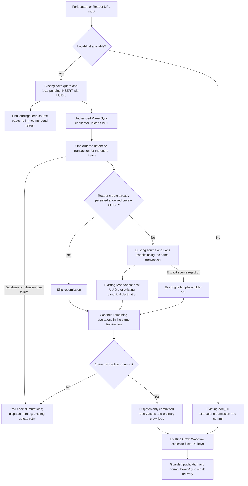
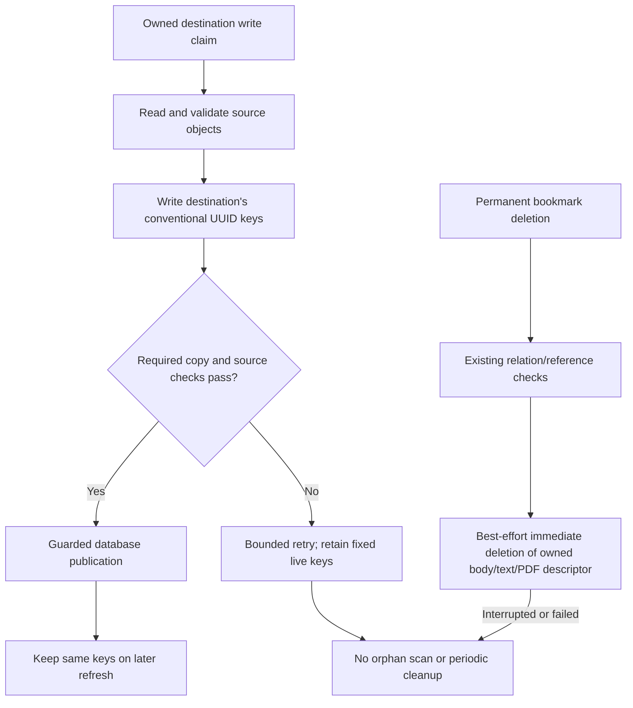
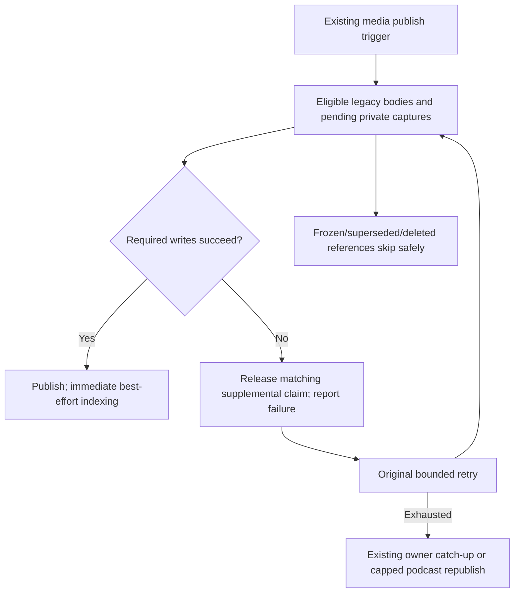
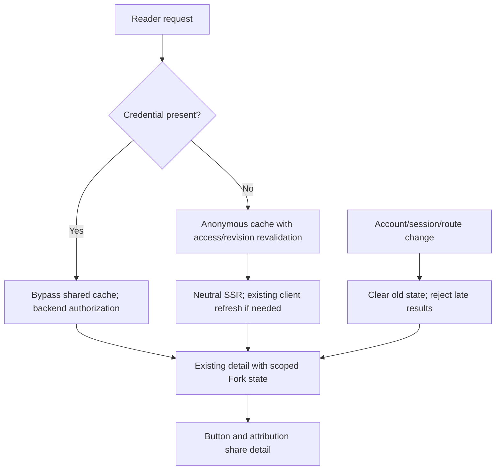

# Bookmark Fork: current implementation

Implemented on 2026-10-23 in `feat/add-bookmark-fork`, [PR #354](https://github.com/slax-lab/slax-reader/pull/354), following the owner's approved simplification. This report supersedes earlier immutable-path, dedicated-endpoint and scheduled-maintenance proposals. [Validation](../../openspec/changes/add-bookmark-fork/validation.md) records actual checks and remaining gaps. After the requested PR-first/local-test handoff, the owner confirmed successful human acceptance at `b5138b59` on 2026-10-23 at 21:42 (Asia/Shanghai), with screenshots showing the Forked source state and Source/Fork attribution on the owned copy. No further adjustments were requested; [acceptance evidence](https://github.com/slax-lab/slax-reader/pull/354#issuecomment-6366331919).

## Review corrections — 2026-10-26

PR reviewer boxcounter identified four bugs in the legacy queue and asynchronous publication boundaries. The follow-up fixes preserve the approved API, database and R2 layout:

| Finding | Correction |
| --- | --- |
| Real queue contexts lack `hashIds` | Construct a fresh context per delivery, with global encoded user identity and that owner's scoped bookmark encoder. |
| A failed delivery blocks the rest of the batch | Dispatch each message independently; generated wiring retries failed IDs and acknowledges successful siblings. Existing retry limits remain unchanged. Pending Reader-shell messages are marked failed under their existing timestamp guard. |
| A duplicate Fork acknowledges admission without durable dispatch | Confirm the deterministic Workflow before returning success for an active duplicate. Lookup uncertainty returns the existing storage error and retains the active claim. |
| Late moderation from A strands capture B | Carry the exact content publication timestamp through durable results. Update moderation only while that timestamp still identifies a successful capture; revoke sharing in the same transaction. Stale moderation performs no write and stops its remaining post-processing. |

The follow-up [boxcounter review 5649104321](https://github.com/slax-lab/slax-reader/pull/354#pullrequestreview-5649104321) identified three remaining boundaries, corrected in three production files:

| Finding | Correction |
| --- | --- |
| Ordinary tweets omitted the publication timestamp and skipped moderation | `domain/crawl.ts` returns `content.publishedRevision` from the ordinary-tweet publisher; Workflow moderation and share revocation now run for this path too. |
| A webhook failure replayed a committed moderation write and skipped completion | `entry/edge/workflows/crawlWorkflow.ts` commits moderation first, then retries the alert in a separate bounded step. An exhausted alert is logged; the committed policy, post-processing, completion event and import accounting remain intact. |
| Global podcast moderation invalidated an active capture's claim | `infra/repository/dbBookmark.ts` applies global policy in one SQL update. Pending/pending_retry/parseing rows retain their timestamp and status, so denied publication can reach the original guarded failure cleanup. Idle rows advance the timestamp to reject older moderation results. All references still lose sharing. |

These changes add no recovery job, table, schema field, endpoint or R2 key convention. PostgreSQL regressions exercise all three active states; Workflow regressions cover ordinary-tweet moderation and both transient/exhausted alert failures. They do not provide general crash or lost-COMMIT recovery.

Historical shared-body cache hits also use the exact timestamp returned by their durable release step, so moderation does not skip post-processing or import completion because of the earlier claim timestamp.

The internal `publishedRevision` is the existing `updated_at` from the successful HTML/media/PDF publication. It adds no version counter, table, migration, scheduled recovery or R2 path. Global podcast moderation continues to reach every episode reference, preserving active capture timestamps so the original finite failure path can finish; completed references still invalidate stale moderation. This correction prevents the identified stale-capture race; it does not introduce general automatic recovery of interrupted `parseing` work.

Current evidence and remaining runtime boundaries are recorded in [validation.md](../../openspec/changes/add-bookmark-fork/validation.md#review-corrections--2026-10-26).

## Behavior and scope

Every new capture belongs to its user. Fork copies the source's saved presentation into the current user's own bookmark, including ordinary articles, shortcuts, uploaded/downloaded PDFs, YouTube and podcasts. Ready media supplements are copied; pending source generation does not subscribe a Fork to future updates. External images/video/audio keep their existing resource behavior. Source deletion does not delete the recipient's copy.

One nullable `sr_user_bookmark.forked_from_id` stores the immediate source relation's integer ID. It is server-owned provenance, not a version counter. There is no new cleanup table, content version, lease or cleanup status. Personal tags, highlights, notes and AI state are not copied. Existing metadata/sharing changes preserve provenance; a successful independent owner capture clears it.

A repeated Reader URL submission refreshes the same personal bookmark and keeps its UUID/personal state. The page button is disabled for a pending request or an active/successful Fork; explicit Add URL remains the deliberate refresh entry. Fork requires a connection. The page stays on the source after acceptance; PowerSync delivers the destination row normally.

## Admission query optimization — 2026-10-26

Source-owner and per-bookmark sharing reads run together after resolving the source relation. URL, PDF and resolved-media acquisition checks also run together before admission. Both groups use `Promise.allSettled` and explicitly inspect failures in the original validation order; missing/deleted owners remain inaccessible and no failed gate admits a write.

Admission reads the private destination once, without loading the unused `userBookmarks` relation. When converting a legacy shared save, it reuses the private bookmark returned by the existing conversion helper. Serializable isolation, source-policy locks/rechecks, destination locking and bounded conflict retries remain in place. Queries inside one interactive transaction still share one connection; wrapping those locks in promises would not parallelize SQL execution.

The pre-Fork ordinary-save implementation already awaited search-cache invalidation and bookmark-event attribute lookup. These remain unchanged: the three KV deletions run in parallel and are awaited; event delivery uses the existing background mechanism after attributes have been loaded. Workflow acceptance is still confirmed before response, and R2 copying stays in the Workflow. There is no PowerSync submission change in this optimization. Reduced query dependencies are verified locally; a deployed response-time improvement requires before/after browser and Worker timing measurements.

## Web PowerSync submission — 2026-10-27

The Web Fork button and Reader URL dialog now reuse ordinary Add URL's local insertion and upload queue. This changes the waiting boundary: the UI acknowledges local SQLite insertion rather than waiting for server admission. It remains online at initiation. A later network interruption uses the existing queue retry behavior.

1. `useBookmarkFork` uses the existing account/URL save guard and `useLocalBookmarks.createBookmark()`. The latter writes the unchanged pending metadata and a local UUID. Reader URL entry already delegates to this hook, so the modal needs no production change.
2. The unchanged PowerSync connector uploads that PUT to `/v1/sync/changes`. `forked_from_id` stays server-owned; detail responses already provide attribution and viewer status. No schema, stream/bucket, migration or contract change is necessary.
3. Sync identifies the trusted Reader origin and executes every ordered bookmark mutation in one transaction. `BookmarkForkService.reserve()` and the existing repository use that same transaction; later edits see the admitted destination. Reader-containing batches reuse Fork Serializable isolation and bounded conflict retries. Any database failure rolls back the entire batch. Only after commit does `dispatch()` reuse the existing Workflow launch. An ordinary-only batch retains its previous isolation and retry count.
4. A new destination uses the submitted UUID and requested archive flag; later queued personal edits apply in order. An existing destination keeps its canonical UUID and personal state. Explicit repeat submissions generate a fresh local UUID and refresh a completed destination through existing admission.
5. Deferred dispatch callbacks are reset on each transaction attempt, so rolled-back/conflicting attempts never launch Workflows. The existing Workflow copies all supported types, rechecks source policy and destination ownership, and publishes provenance. None of its R2, finite retry or cleanup code changes in this follow-up.
6. The local hook marks the button saved without emitting an immediate server-detail refresh, which could otherwise clear the acknowledgement before upload. Later visits retain existing viewer-scoped detail behavior. Local queue acceptance does not guarantee successful copying.

If local-first is unavailable, Web retains `POST /v1/bookmark/add_url` with `{ "target_url": "https://<reader>/b/<source-uuid>", "tags": [] }`. Its `{ "bmId": "" }` response still acknowledges admission and durable dispatch; HTTP acceptance still refreshes existing detail once. Extension, Telegram/import adapters and ordinary HTTP saves retain their current behavior. No `/fork` or `/fork_metadata` endpoint returns.

### Replay and failure boundaries

| Situation | Behavior |
| --- | --- |
| Later mutation fails in a mixed upload | Roll back prior ordinary saves, Reader reservations and failure placeholders together; dispatch no Workflow. |
| Transaction conflict | Retry the entire transaction within the existing Fork budget, clearing deferred effects from rolled-back attempts. |
| Double-click or repeated URL while local save is pending | Existing account/URL guard prevents a second local insert. |
| Response lost after the submitted UUID persisted | Check UUID plus relation owner plus private resource owner; acknowledge without revalidating a source that may have disappeared. Later queued edits continue. |
| Source unavailable, denied, not ready, or acquisition gate disabled before admission | Reuse the existing failed Reader placeholder. Preserve its local UUID for personal edits and removal; do not crawl the Reader shell. |
| Database or other infrastructure error before admission | Reject upload so the unchanged connector retries. |
| Existing target is busy, or dispatch confirmation is uncertain after admission | Acknowledge the persisted resource, retain its active claim and let other uploads proceed. Do not reset it or launch ordinary crawling. |
| R2 copy fails | Existing bounded Workflow retries and guarded failure transition. No new rescue or maintenance. |
| User repeats a completed save through Add URL | A new local command uses existing admission to refresh the same private destination and preserve personal state. |

A later database failure no longer exposes ordinary saves to replay after a partial batch commit. A response lost after a fully successful commit still has the inherited replay behavior.

Database uniqueness on `(target_url, private_user)` and existing conditional admission select one destination/writer. Client UUID ownership remains checked. A fresh local UUID can differ from an existing destination's canonical UUID; dependent edits against that temporary UUID, replay after deletion, repeated refresh on an existing-target replay and account/queue lifecycle boundaries remain the explicitly accepted ordinary-save limitations. There is no UUID alias registry, command receipt, new version, new state or additional recovery job. Uncertain dispatch can remain processing and may require investigation.

Deploy API support before the local-first Web change: an older server still creates failed placeholders for Reader PUTs. Reverting Web restores HTTP submission, but pending local Reader PUTs still require the new API. No database or R2 migration is required.

This follow-up changes eight handwritten production files plus regenerated DI wiring, with seven test files and documentation. Existing Fork admission and own-source restore accept the caller transaction. Labs permission reads also reuse that transaction: the deployed pool has one connection, so using the global client while holding a transaction would otherwise wait on itself. HTTP callers omit this optional transaction and retain their previous behavior. The original fixed-path copying/deletion details below remain applicable.

## R2 paths, copying and deletion

| Content | Destination keys |
| --- | --- |
| HTML, YouTube, podcast | `html/body/<UUID>.html`, `text/body/<UUID>.txt` |
| PDF | `pdf/body/<UUID>.pdf`, `pdf/meta/<UUID>.json`, optional `text/pdf/<UUID>.txt` |
| Shortcut | No body objects |

No `snapshots/`, `forks/` or per-attempt directory is introduced. Media supplements are embedded in an inert JSON block in the existing HTML; this is content representation, not relational provenance or a job queue. PDF metadata retains the existing descriptor path. Uploaded PDFs use the recipient's existing upload identity rules.

HTML copying derives matching text from the validated saved HTML, rather than copying a potentially stale historical text object. Source ETag/read checks, permission revalidation and destination write ownership remain. Supplemental media publication writes text first, then HTML and its manifest together, preventing an early text failure from erasing the pending manifest. The ordinary webpage fetch/parse → required R2 writes → database success sequence is retained.

Fixed keys do not provide atomic rollback across R2 objects and PostgreSQL. A partial write can remain after failure, and an interrupted deletion can leave objects. A crashed active write/uncertain dispatch can require investigation. These are accepted boundaries: no automatic scan, cleanup table, recovery lease or new state field is added. Historical shared conversion may temporarily lose that user's readable content until retry; other users' original shared content is retained.

## Original retries; no new maintenance job

Removed `SnapshotMaintenanceJob`, `SnapshotMaintenanceService`, database enumeration/cursor, generated registration and `snapshot-index:*` KV markers. Old marker values are inert and need no migration/scan. Existing canonical media retention, recycle-bin/account deletion, ordinary pending rescue and podcast republish jobs remain for their original purposes.

| Failure | Current handling |
| --- | --- |
| Fork required copy | Existing finite Crawl Workflow retries, then guarded failure |
| Search/embedding after content success | Immediate best effort and existing error reporting; no scheduled repair |
| YouTube publication | Existing bounded publish step and owner status catch-up |
| Podcast publication | Existing bounded publish step and existing capped republish/sweep |
| Frozen Fork or superseded media input | Skip; never subscribe to later generation |

Per-reference publication processes independent recipients and propagates genuine incomplete writes to the original retry caller. Supplemental write failure releases only its own claim back to the completed base state and advances existing `updated_at`; a stale release cannot free a later writer. Workflow-owned acquisition keeps its finite retry ownership. This restores retry eligibility without admitting every failed bookmark or adding a new persistent recovery mechanism.

## Detail state and cache isolation

Both `ContentOrchestrator.getContentMeta()` and `BookmarkOrchestrator.bookmarkDetail()` project `has_fork`, safe `fork`, and `viewer_fork_status` from their already-authorized destination. Source lookup uses the immutable source relation ID, current access, matching resource identity and source-owner display settings. Missing/revoked/rebound sources show an unavailable marker. The button and Source/Fork area share this result; there is no separate metadata endpoint or component fetch.

| Context | Behavior |
| --- | --- |
| Anonymous SSR | Existing visitor cache, permission/revision revalidation, neutral Fork attribution |
| Any token cookie or supported authorization header, including invalid/expired credentials | Bypass both shared-cache reads and writes; `private, no-store`; backend authenticates |
| PDF SSR | Title/type-only hydration; existing client detail refresh loads descriptor and viewer state |
| Login/logout/account/session change | Clear previous details/marks/local ownership immediately; ignore old async completions; refresh only when online |
| Route change | Remount and clear old detail state |

Profile failure invalidation refreshes scoped content without recursively retrying the same failing profile query. A delayed local database lookup cannot restore the previous account's owner controls. No token is serialized into cache/state keys. This intentionally trades authenticated shared-cache hits for simpler, safer detail reuse; anonymous caching remains.

## Review scope and file-count audit

Comparison uses rename-aware PR diffs against merge base `18f0dd6c`, not the number of files touched by this follow-up commit. Before simplification (`e70bfb2e`) the PR had 162 changed files. The simplification at `a9bfeffb` has **155 files**: API production/config/migration 39, API generated 1, Web 19, Extension 2, contracts 3, tests 62 and docs/OpenSpec 29. The subsequent CI repair adds one existing Labs test file to the PR diff (**156 files**, including 63 test files), removes competing mocks without changing product behavior, and clarifies historical acceptance. The count and scope are recorded in validation.md. The previous growth from 131 to 162 included 17 additional test files and 13 production/config files; tests did not explain all growth. The 17 media-archive dependency files were already in the initial count.

This refinement removes redundant maintenance/controller/generated/client metadata paths, public-only command types, unused `can_fork`, `retiredKey` plumbing and an inert key-builder attempt argument. It keeps all-format isolation, source authorization, write ownership, old-client compatibility, immediate deletion and meaningful tests. It does not merge services solely to lower the file count.

Independent Bugs/Security/Compliance review found two account-state issues (late local ownership and recursive profile retry); both were fixed and rechecked. Final inspection also added the existing initialization refresh for an absent detail result after a session change during initial loading. Verification covers real local API/Workflow/PostgreSQL/R2 plus isolated cache-boundary and action tests. It does not claim production deployment, real provider generation, live browser-to-PowerSync transport, or process-kill recovery. Renewed owner acceptance is separately recorded in validation.md and supported by the supplied reader screenshots. Application versions remain unchanged per the owner's prior decision.
