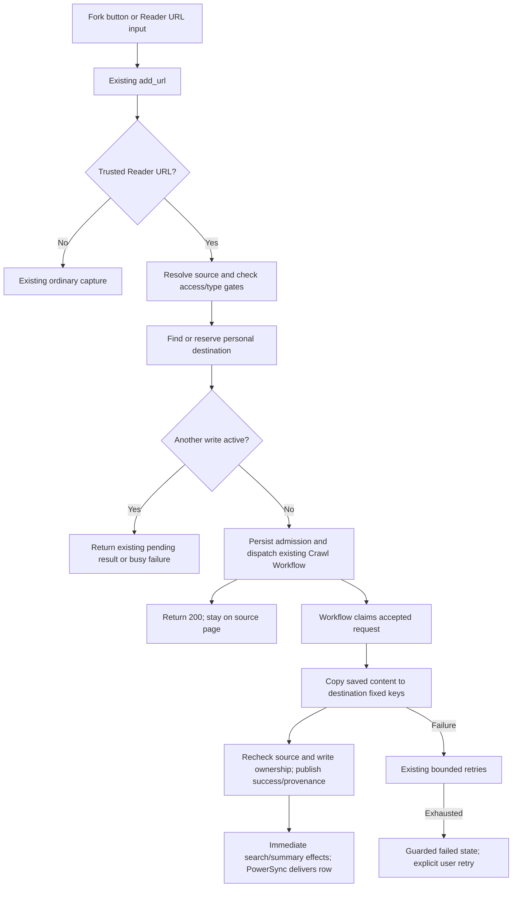
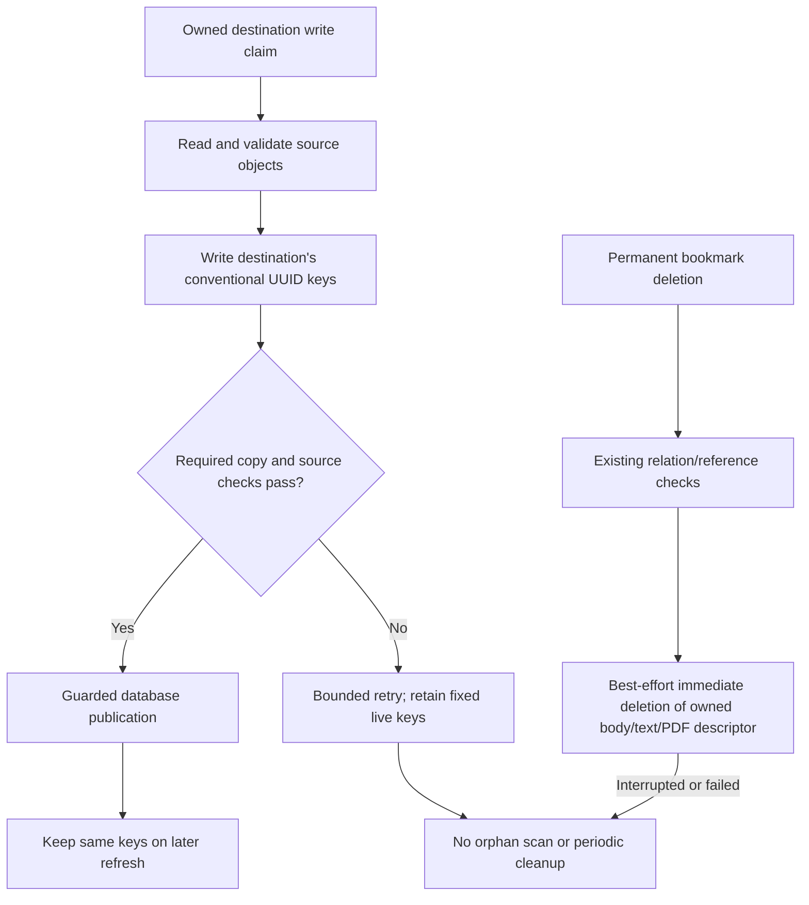
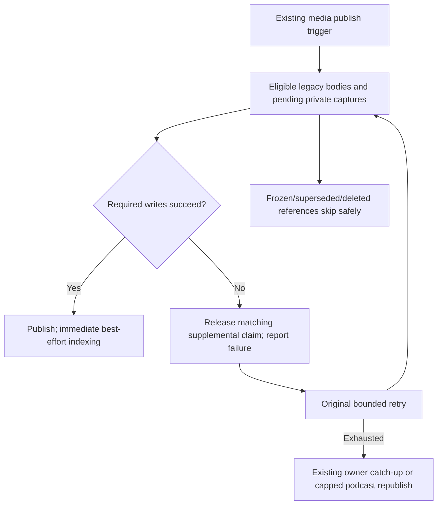
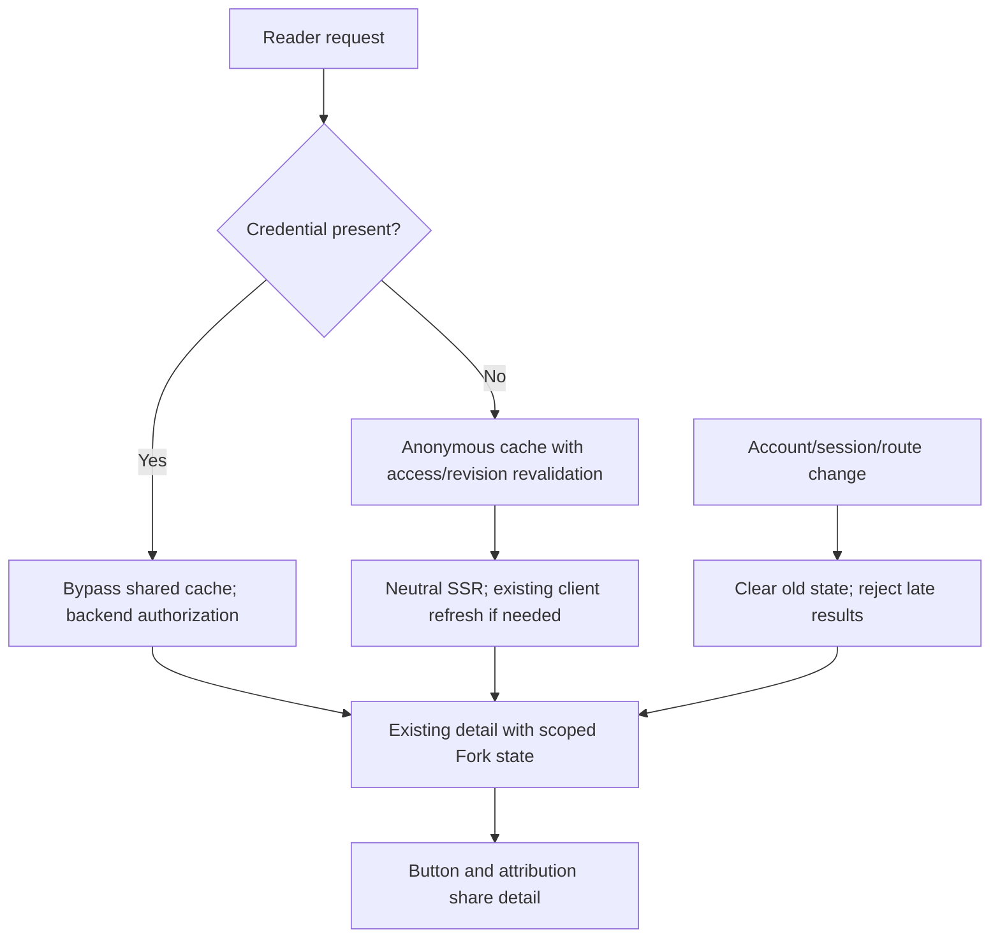

# Bookmark Fork: current implementation

Implemented on 2026-10-23 in `feat/add-bookmark-fork`, [PR #354](https://github.com/slax-lab/slax-reader/pull/354), following the owner's approved simplification. This report supersedes earlier immutable-path, dedicated-endpoint and scheduled-maintenance proposals. [Validation](../../openspec/changes/add-bookmark-fork/validation.md) records actual checks and remaining gaps. The owner requested the PR update before another local test; renewed human acceptance is pending.

## Behavior and scope

Every new capture belongs to its user. Fork copies the source's saved presentation into the current user's own bookmark, including ordinary articles, shortcuts, uploaded/downloaded PDFs, YouTube and podcasts. Ready media supplements are copied; pending source generation does not subscribe a Fork to future updates. External images/video/audio keep their existing resource behavior. Source deletion does not delete the recipient's copy.

One nullable `sr_user_bookmark.forked_from_id` stores the immediate source relation's integer ID. It is server-owned provenance, not a version counter. There is no new cleanup table, content version, lease or cleanup status. Personal tags, highlights, notes and AI state are not copied. Existing metadata/sharing changes preserve provenance; a successful independent owner capture clears it.

A repeated Reader URL submission refreshes the same personal bookmark and keeps its UUID/personal state. The page button is disabled for a pending request or an active/successful Fork; explicit Add URL remains the deliberate refresh entry. Fork requires a connection. The page stays on the source after acceptance; PowerSync delivers the destination row normally.

## Existing save endpoint and workflow

The button and Reader URL dialog submit:

```http
POST /v1/bookmark/add_url
Content-Type: application/json

{"target_url":"https://<configured-reader-origin>/b/<source-uuid>","tags":[]}
```

The existing success envelope carries `data: { "bmId": "" }`. This acknowledges persisted admission and accepted durable dispatch, not completed R2 copying. A failed response envelope is not success. Source/permission/busy/Labs failures retain meaningful existing error conventions. The page refreshes its existing detail once after acceptance; refresh failure does not undo the accepted submission.

`/fork` and `/fork_metadata` are removed from this unreleased change. Reader detection in `add_url`/Extension `add` delegates to the existing Fork domain service before crawling. Ordinary external-URL saves retain their original path. Telegram/import adapters retain actual-completion accounting. Old queued Reader creates retain their explicit compatibility handling rather than crawling the Reader shell.



Database uniqueness on `(target_url, private_user)` and conditional existing-state admission select one destination/writer. Accepted timestamps identify the request; stale execution cannot publish over a newer owner request. `pending`/`pending_retry`/`parseing` and the original retry machinery are reused. Ambiguous dispatch keeps its claim rather than assuming no writer exists. No automatic timeout takeover is added.

## R2 paths, copying and deletion

| Content | Destination keys |
| --- | --- |
| HTML, YouTube, podcast | `html/body/<UUID>.html`, `text/body/<UUID>.txt` |
| PDF | `pdf/body/<UUID>.pdf`, `pdf/meta/<UUID>.json`, optional `text/pdf/<UUID>.txt` |
| Shortcut | No body objects |

No `snapshots/`, `forks/` or per-attempt directory is introduced. Media supplements are embedded in an inert JSON block in the existing HTML; this is content representation, not relational provenance or a job queue. PDF metadata retains the existing descriptor path. Uploaded PDFs use the recipient's existing upload identity rules.

HTML copying derives matching text from the validated saved HTML, rather than copying a potentially stale historical text object. Source ETag/read checks, permission revalidation and destination write ownership remain. Supplemental media publication writes text first, then HTML and its manifest together, preventing an early text failure from erasing the pending manifest. The ordinary webpage fetch/parse → required R2 writes → database success sequence is retained.



Fixed keys do not provide atomic rollback across R2 objects and PostgreSQL. A partial write can remain after failure, and an interrupted deletion can leave objects. A crashed active write/uncertain dispatch can require investigation. These are accepted boundaries: no automatic scan, cleanup table, recovery lease or new state field is added. Historical shared conversion may temporarily lose that user's readable content until retry; other users' original shared content is retained.

## Original retries; no new maintenance job

Removed `SnapshotMaintenanceJob`, `SnapshotMaintenanceService`, database enumeration/cursor, generated registration and `snapshot-index:*` KV markers. Old marker values are inert and need no migration/scan. Existing canonical media retention, recycle-bin/account deletion, ordinary pending rescue and podcast republish jobs remain for their original purposes.

| Failure | Current handling |
| --- | --- |
| Fork required copy | Existing finite Crawl Workflow retries, then guarded failure |
| Search/embedding after content success | Immediate best effort and existing error reporting; no scheduled repair |
| YouTube publication | Existing bounded publish step and owner status catch-up |
| Podcast publication | Existing bounded publish step and existing capped republish/sweep |
| Frozen Fork or superseded media input | Skip; never subscribe to later generation |

Per-reference publication processes independent recipients and propagates genuine incomplete writes to the original retry caller. Supplemental write failure releases only its own claim back to the completed base state and advances existing `updated_at`; a stale release cannot free a later writer. Workflow-owned acquisition keeps its finite retry ownership. This restores retry eligibility without admitting every failed bookmark or adding a new persistent recovery mechanism.



## Detail state and cache isolation

Both `ContentOrchestrator.getContentMeta()` and `BookmarkOrchestrator.bookmarkDetail()` project `has_fork`, safe `fork`, and `viewer_fork_status` from their already-authorized destination. Source lookup uses the immutable source relation ID, current access, matching resource identity and source-owner display settings. Missing/revoked/rebound sources show an unavailable marker. The button and Source/Fork area share this result; there is no separate metadata endpoint or component fetch.

| Context | Behavior |
| --- | --- |
| Anonymous SSR | Existing visitor cache, permission/revision revalidation, neutral Fork attribution |
| Any token cookie or supported authorization header, including invalid/expired credentials | Bypass both shared-cache reads and writes; `private, no-store`; backend authenticates |
| PDF SSR | Title/type-only hydration; existing client detail refresh loads descriptor and viewer state |
| Login/logout/account/session change | Clear previous details/marks/local ownership immediately; ignore old async completions; refresh only when online |
| Route change | Remount and clear old detail state |

Profile failure invalidation refreshes scoped content without recursively retrying the same failing profile query. A delayed local database lookup cannot restore the previous account's owner controls. No token is serialized into cache/state keys. This intentionally trades authenticated shared-cache hits for simpler, safer detail reuse; anonymous caching remains.



## Review scope and file-count audit

Comparison uses rename-aware PR diffs against merge base `18f0dd6c`, not the number of files touched by this follow-up commit. Before simplification (`e70bfb2e`) the PR had 162 changed files. The simplification at `a9bfeffb` has **155 files**: API production/config/migration 39, API generated 1, Web 19, Extension 2, contracts 3, tests 62 and docs/OpenSpec 29. The subsequent CI repair adds one existing Labs test file to the PR diff (**156 files**, including 63 test files), removes competing mocks without changing product behavior, and clarifies historical acceptance. The count and scope are recorded in validation.md. The previous growth from 131 to 162 included 17 additional test files and 13 production/config files; tests did not explain all growth. The 17 media-archive dependency files were already in the initial count.

This refinement removes redundant maintenance/controller/generated/client metadata paths, public-only command types, unused `can_fork`, `retiredKey` plumbing and an inert key-builder attempt argument. It keeps all-format isolation, source authorization, write ownership, old-client compatibility, immediate deletion and meaningful tests. It does not merge services solely to lower the file count.

Independent Bugs/Security/Compliance review found two account-state issues (late local ownership and recursive profile retry); both were fixed and rechecked. Final inspection also added the existing initialization refresh for an absent detail result after a session change during initial loading. Verification covers real local API/Workflow/PostgreSQL/R2 plus isolated cache-boundary and action tests. It does not claim production deployment, real provider generation, live browser-to-PowerSync transport, process-kill recovery, or renewed owner acceptance. Application versions remain unchanged per the owner's prior decision.
