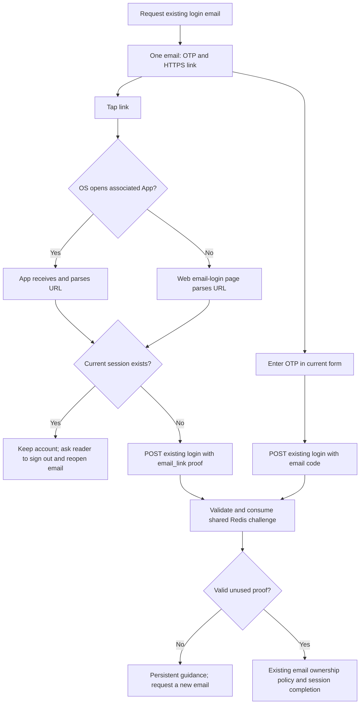

# Design

## Context

See [proposal.md](proposal.md) for scope. Baseline: `origin/dev` at `01b202d5`.

`UserController.handleSendEmailCodeRequest` parses the delivery request, `UserService.sendEmailCode` resolves the recipient, and the injected `EmailCodeService` owns issuance/verification. `EmailChallengeRepo` in `infra/repository/redisEmailChallenge.ts` owns Redis TTL, counters, and compare-and-delete. Resend is already an infra adapter. `UserService.loginByVerifiedEmail` applies existing identity policy and session completion.

Web `useAuth` and Mobile session acceptance protect existing sessions. Mobile has no email URL listener. Current AASA and Digital Asset Links files authorize Passkeys only: `webcredentials` / `common.get_login_creds` do not establish Universal Links / App Links.

## Goals / Non-Goals

**Goals:** Add a second proof for the existing email login challenge, a focused HTTPS entry, and native URL delivery. Preserve existing file owners, DI, naming, and call order.

**Non-Goals:** New auth endpoints; account switching/merging; link-based mailbox binding; database/schema or PowerSync changes; a new email provider; generalized auth frameworks; device-bound links; original-tab polling; new signing trust; OAuth/Passkey refactoring; login/settings redesign.

## Decisions

### 1. Extend existing contracts and orchestration

Keep `RESTMethodPath.LOGIN_EMAIL_SEND` and `RESTMethodPath.LOGIN`. Add `EmailLinkInput { email, request_id, token }` and `EmailLinkLoginRequest` with discriminator `type: 'email_link'` in `packages/contracts/src/email-auth.ts`, and extend the API's existing `UserLoginRequest` union. `EmailCodeChallenge` and the send request remain compatible; no client-supplied callback URL or source field is needed. Both Web- and App-requested login emails include code and link.

`handleUserLoginRequest` still delegates to `UserService.userLogin`. Its new branch verifies the link through the injected `EmailCodeService`, then uses `loginByVerifiedEmail`. The binding platform remains `mail` and the login result/analytics method remains `email`; link proof is not a new account type. `LoginIdentityService`, repositories' account policy boundaries, and provider-link routes remain unchanged.

Alternative: a separate link-verification endpoint/service would duplicate challenge and session policy. A new branch within the current owners is the smaller coherent change.

### 2. One Redis challenge, two proofs

For `purpose: 'login'`, generate a random 32-byte URL-safe token. Store its SHA-256 digest as an optional `linkDigest` on the existing challenge alongside the OTP digest. Retain current environment/purpose/address keys, five-minute TTL, resend cooldown, send limits, and shared five-attempt budget. Build the link with the normalized `emailKey`; `verifyLink` uses that key and request ID, compares the token digest, and uses the existing compare-and-delete before returning the verified key and Redis-stored `recipient`. Successful OTP or link verification removes the same record. Resend replaces both proofs without extending an old generation's lifetime. Keep the existing save → send → explicit-rejection cleanup order.

`purpose: 'bind'` remains OTP-only. Existing challenges without `linkDigest` keep their normal OTP path; they cannot authenticate through a link. No reverse index, extra Redis round-trip lookup scheme, HMAC secret, SQL lock, or new Lua workflow is needed. Redis commands remain exclusively in infra.

Keep constants in `src/const/emailCode.ts`; pure token/URL/message helpers belong in `src/utils/emailCode.ts`. Domain owns issuance and verification decisions; infra only persists challenges or sends the prepared Resend message. Reuse existing DI and regenerate owned artifacts during implementation.

### 3. HTTPS URL and credential handling

Use the configured API `FRONT_END_URL` origin:

```text
https://<web-host>/email-login#email=<encoded-address>&request_id=<id>&token=<secret>
```

The fragment avoids sending the proof in the landing page's HTTP request. The send API returns only its existing challenge metadata; the secret is delivered only inside the email. A public GET never verifies or consumes a challenge. Local Web/fixture tests may retain an explicitly configured HTTP localhost origin; do not rewrite its scheme or introduce global configuration checks that disable existing OTP behavior. Published email-link origins use HTTPS.

Clients validate the expected origin, exact path, and proof shape at the incoming URL boundary, then submit typed values in the `/login` request body. The API validates that external body once at its existing domain input boundary. Do not log raw incoming URLs, proof bodies, or email contents. No arbitrary `redirect` or API origin is accepted from the link.

On Web, capture the fragment into transient client memory and remove it from the current entry path before analytics/third-party script execution, for both `/email-login` and `/email-login-web`. Use a focused critical-head capture script (the existing reader-startup pattern) and a pure parser; verify actual ordering against the installed Nuxt scripts integration and existing critical-head pattern. Do not change unrelated analytics behavior. The page consumes that memory once; reloading requires reopening the email. Keep email-link click tracking disabled in the Resend domain settings so rewriting does not interfere with native link routing.

Alternative: query-string proofs are simpler to parse but appear in HTTP URLs; a database token lookup adds storage and indexing without helping this existing address-keyed challenge.

### 4. Web and App entry flow



**Web:** Add flat `app/pages/email-login.vue` and a focused `useEmailLinkLogin` composable. Give the same page a browser-only alias `/email-login-web`, outside the exact native association path. Both entries use the same parsing/scrubbing, auth middleware/public startup classification, and flow; there is no second authentication implementation. They must be reachable with and without a session. Use existing `useAuth` cookie/session completion and cancellation conventions. Automatically submit a valid proof only when unauthenticated. Show loading, invalid/expired/used-link guidance, or existing-session guidance. A new-email action returns to the normal email form; do not automatically replay a consumed proof. Link login defaults to bookmarks; it does not restore another device/tab's destination. Existing OTP return destinations remain unchanged.

**Mobile:** Wire a small React Native Linking adapter at composition to a focused auth lifecycle owner (`auth/useEmailLinkLogin.ts`). Handle both `getInitialURL()` and warm `url` events; retain an initial event in memory only until local session readiness. An authenticated reader sees the sign-out instruction first, with no login request or proof consumption. For an unauthenticated reader, enter the existing login agreement UI before submission: its checkbox is transient screen state, so receipt of a link is not evidence of agreement on that device. On agreement, submit the pending proof; on refusal/disposal, discard it without an API request. Web retains its existing terms notice rather than adding a checkbox. Reuse typed API transport (public access, no automatic retry, abortable, existing device ID policy) and `sessions.accept`; keep account transitions out of screens, presentation, and the native adapter. Dispose listeners and cancel/discard abandoned requests on account/origin replacement; coalesce duplicate native delivery only within the active attempt, without a persistent replay framework. Success opens the existing authenticated shell. Failure offers the existing email flow.

**Active environment:** Native runtime currently changes the active API on Beta selection without updating `config.webUrl` (`runtime.tsx`). Resolve the expected email-link origin from composition's existing configured primary API, Beta API, Web URL, and active API: use the configured Web origin for the primary/development API; use `https://r-beta.slax.com` when the separately configured Beta API is selected. Primary wins when both configured APIs are identical. Keep this small policy within email-link parsing; do not rewrite global config, Web cookies, or Passkey behavior. Match the incoming origin/path before submitting; the URL never selects an API. If an unauthenticated App intercepts an OS-declared public host while another environment is active, display environment guidance and an explicit “Continue on Web” action that opens that known host's `/email-login-web` alias with the original fragment. The alias avoids an App-opening loop and uses that site's own configured API. Unknown hosts/paths are rejected without opening an arbitrary URL.

The OS decides App versus browser routing; the Web page does not repeatedly attempt a custom scheme. If App opening is disabled, unsupported, or unavailable, Web remains usable.

### 5. Associations and file ownership

| Owner | Minimal implementation surface |
| --- | --- |
| Contract | `packages/contracts/src/email-auth.ts`; existing route constants remain the sole list |
| HTTP/domain | Existing `handler/http/userController.ts`, `domain/user.ts`, `domain/emailCode.ts`; retain `handle*Request` and `*Service` conventions |
| Const/utils/infra | Existing `const/emailCode.ts`, `utils/emailCode.ts`, `infra/repository/redisEmailChallenge.ts`, existing i18n messages and Resend adapter |
| Web | Focused page/composable/URL boundary; existing `useAuth`, auth middleware, public startup policy |
| Mobile | Focused auth hook/parser, native Linking adapter, typed `data/api.ts` endpoint method, composition wiring |
| Native build | `apps/mobile/app.config.ts` owns Expo `applinks:` domains and path-scoped Android auto-verified intent filters; do not hand-edit generated projects or repurpose `with-passkeys.cjs` |
| Public association | Existing `.well-known/apple-app-site-association` and `assetlinks.json`; preserve Passkey entries, app IDs and fingerprints |

Add iOS `applinks` AASA components for the exact `/email-login` path and Android `common.handle_all_urls` plus exact manifest path filtering. Apply to `r.slax.dev` (preview), `r-beta.slax.com` (beta), and `r.slax.com` (production). Development remains local development; do not equate it with preview. Fixture builds retain isolation. Do not trust debug/upload certificates as part of this change.

## Risks / Trade-offs

- **Link routing depends on OS/browser preferences and signed association** → Web is the specified fallback; verify both supported signed native packages and browser continuation, including a public link intercepted by the App while another API environment is active. Do not claim an untrusted local Android APK proves App Links.
- **A link can be opened on another device** → possession of the email proof authorizes that client, as required; it does not sign the original requesting tab into an account.
- **A client abandons a request after the server consumes proof** → no client-side session is written after abandonment; ask for a fresh email rather than replaying automatically. This is the existing one-time-proof trade-off.
- **Email clients may rewrite links or strip fragments** → disable Resend click tracking and verify representative actual delivered mail on iOS/Android and Web. The OTP remains available in that same email; do not add a second token transport silently.

## Migration Plan

No database migration or new environment variable. Publish the Web landing page and path-limited association updates before the API begins including links in email; deploy API proof support before relying on new native binaries. Older clients continue using the unchanged send response and OTP request. During staged delivery, older native builds without a handler open the Web page.

If live native acceptance needs published associations before a feature PR can open, split only the association/config support into a separately reviewed Draft PR after explicit approval, as with the Passkey support work. Do not merge or deploy automatically. Before delivery, confirm the affected Mobile version and obtain Web/iOS/Android hands-on acceptance. Rollback stops adding links to new messages first; existing proofs naturally expire within five minutes. Existing OTP and Passkey login remain available.

## References

- [React Native Linking](https://reactnative.dev/docs/linking): initial URL and warm URL events.
- [Apple Universal Links](https://developer.apple.com/documentation/xcode/supporting-universal-links-in-your-app): website association and incoming URL delivery.
- [Android App Links](https://developer.android.com/training/app-links/add-applinks): verified intent filters and URL scope.
- [URI fragments](https://developer.mozilla.org/en-US/docs/Web/URI/Reference/Fragment): fragments are processed by the client rather than sent in the HTTP resource request.
- [Resend tracking](https://resend.com/docs/dashboard/domains/tracking): click tracking is domain-scoped, disabled by default, and rewrites tracked links.
